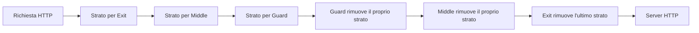
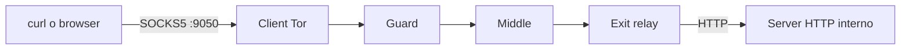
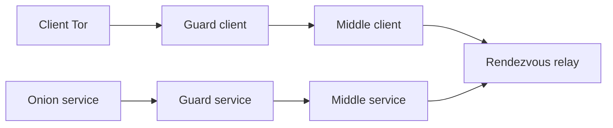

# Rete Tor privata per esperimenti

La repository contiene una rete Tor privata e isolata, usata per confrontare un
servizio clearnet interno e un onion service.

> Stato: questa è una base sperimentale temporanea. Il modello di minaccia e
> gli esperimenti definitivi devono essere confermati dal professore prima di
> aggiungere packet capture, analisi o nuovi attacchi.

## Regole del laboratorio

- Tutti i nodi restano nella VM e nelle reti Docker private.
- Non eseguire esperimenti sulla rete Tor pubblica.
- Le configurazioni che consentono destinazioni private o HTTP esistono solo
  per questo ambiente isolato e non sono adatte a un relay pubblico.

## Da dove iniziare

| Documento | Quando leggerlo |
| --- | --- |
| [`docs/GETTING_STARTED.md`](docs/GETTING_STARTED.md) | Per installare, avviare e provare onion service e clearnet. |
| [`docs/PROJECT_PLAN.md`](docs/PROJECT_PLAN.md) | Per obiettivi, architettura, esperimenti e divisione del lavoro. |
| [`docs/UPSTREAM_NOTES.md`](docs/UPSTREAM_NOTES.md) | Per provenienza della base e note tecniche upstream. |

## Basi teoriche essenziali

Tor è una rete di anonimizzazione a bassa latenza. Invece di collegarsi
direttamente al server, il client crea un circuito attraverso più relay. Ogni
relay conosce solo il nodo precedente e il nodo successivo: nessun relay
intermedio conosce contemporaneamente identità del client e destinazione.

Prima di creare un circuito, il client scarica il **consensus**: un documento
firmato dalle directory authorities che elenca relay, chiavi, indirizzi e flag
disponibili. Il client sceglie poi normalmente un guard, un middle relay e,
per una destinazione non onion, un exit relay.

### Cifratura a strati

Il nome *Onion Router* deriva dalla cifratura a strati. Per un circuito
`Client → Guard → Middle → Exit`, il client prepara il traffico in modo che:

Il guard sa quale client gli ha aperto il circuito, ma non conosce la
destinazione finale. L'exit conosce la destinazione, ma riceve traffico dal
middle e non conosce l'IP del client.

Questa proprietà non rende Tor invulnerabile: un osservatore che controlli o
osservi entrambi gli estremi del circuito può confrontare tempi, direzione,
dimensione dei burst e volume del traffico. Questo è il modello sperimentale
alla base del progetto.

Ruoli principali:

- **Directory authority**: pubblica il consensus, cioè la lista firmata dei
  relay disponibili.
- **Guard**: primo relay scelto dal client.
- **Middle relay**: inoltra traffico tra guard ed exit/rendezvous.
- **Exit relay**: ultimo relay per una destinazione clearnet.
- **Onion service**: server pubblicato con un indirizzo `.onion`.
- **Rendezvous relay**: punto d'incontro dei circuiti client e onion service.

### Scenario clearnet interno

Il server HTTP registra l'IP dell'exit, non quello del client. Nel laboratorio
il server è interno a Docker, ma il ruolo dell'exit resta lo stesso del caso
clearnet classico.

### Scenario onion service

Non c'è un exit relay: client e onion service non rivelano direttamente il
proprio IP all'altro lato. Il client ottiene le informazioni del servizio,
sceglie un rendezvous relay e costruisce il proprio circuito; il servizio
costruisce separatamente un circuito verso lo stesso rendezvous.

Per l'esperimento onion, un attaccante realistico non osserva direttamente il
container onion service. Le osservazioni usate per il matching sono quelle del
guard del client e del guard del servizio; i log del servizio servono solo
come ground truth per verificare il risultato.

## Stato delle prove

Sono già state verificate:

- richiesta HTTP verso un onion service attraverso SOCKS5;
- richiesta HTTP verso un server clearnet interno;
- separazione tra le reti Docker `testing-tor` e `clearnet-target`;
- server clearnet che osserva l'exit relay come peer TCP.

Per i comandi completi e riproducibili, seguire
[`docs/GETTING_STARTED.md`](docs/GETTING_STARTED.md).
