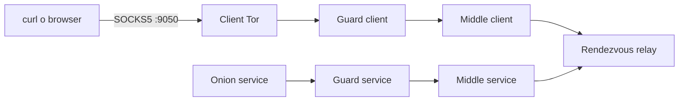
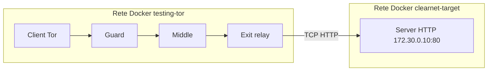
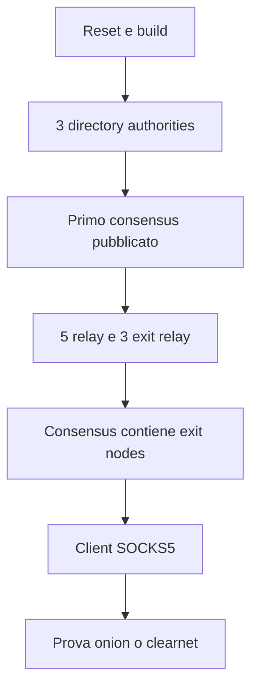

# Getting started

Questa guida permette di riprodurre le due prove base della repository:

1. accesso a un onion service;
2. accesso a un normale server HTTP clearnet interno tramite exit relay.

Tutto resta nella VM e nelle reti Docker private. Non viene utilizzata la rete
Tor pubblica.

## Le due prove in sintesi

### Onion service

Il client e il servizio non comunicano direttamente. I due lati costruiscono
circuiti che si incontrano in un rendezvous relay.



### Clearnet interno

Il target HTTP è su una seconda LAN Docker. Solo l'exit relay appartiene a
entrambe le reti, quindi il client non può raggiungere direttamente il server.



## Prerequisiti

Eseguire i comandi nella VM Linux, non nel terminale macOS:

```bash
cd ~/progetto_network/tor-testing-network
newgrp docker
source .venv311/bin/activate
docker info
```

Se `docker info` funziona, la CLI Python e l'immagine Tor sono pronte. Se
necessario, installare prima Python 3.11 e il modulo venv:

```bash
sudo apt update
sudo apt install -y python3.11 python3.11-venv
```

## Reset completo dell'ambiente

Questa procedura elimina i container e lo stato runtime della rete di test.
Non elimina il codice della repository.

```bash
docker ps -a --filter name=testing-tor- -q | xargs -r docker rm -f
docker rm -f clearnet-target-web 2>/dev/null || true

docker network rm clearnet-target 2>/dev/null || true
docker network rm testing-tor 2>/dev/null || true
docker volume rm testing-tor 2>/dev/null || true

rm -f cli/status.json

docker volume create testing-tor
docker network create testing-tor --subnet 10.5.0.0/16
docker build -t testing-tor docker
```

## Avvio della rete Tor

Seguire l'ordine sotto. Il client va creato solo dopo che il consensus include
gli exit relay.



### Directory authorities

```bash
python cli/main.py container add-da --count 3
python cli/main.py container list --filter "-da-"
```

Sostituire `NOME` con uno dei nomi restituiti:

```bash
docker logs -f testing-tor-da-NOME
```

Attendere:

```text
Published ns consensus
Published microdesc consensus
```

Premere `Ctrl+C` per interrompere solo la visualizzazione dei log.

### Relay ed exit relay

```bash
python cli/main.py container add-relay --count 5
python cli/main.py container add-exit --count 3
```

Attendere un nuovo consensus. Per lo scenario clearnet deve comparire anche:

```text
The current consensus contains exit nodes
```

Senza questa riga il client non può costruire un circuito verso un servizio
clearnet.

## Prova onion service

Creare un onion service e un client:

```bash
python cli/main.py container add-hs
python cli/main.py container add-client --port 9050
python cli/main.py container list
```

Annotare il nome del container onion service, poi avviare un server HTTP al
suo interno:

```bash
docker exec -it testing-tor-hs-NOME bash
mkdir -p /tmp/webroot
echo "<h1>Hello from my private Tor network</h1>" > /tmp/webroot/index.html
python3 -m http.server 80 --directory /tmp/webroot
```

In un altro terminale recuperare l'indirizzo onion:

```bash
python cli/main.py container get-onion-domain testing-tor-hs-NOME
```

Testare la richiesta dal client SOCKS:

```bash
curl --socks5-hostname 127.0.0.1:9050 http://INDIRIZZO_ONION
```

La risposta attesa è la pagina HTML appena creata.

## Prova clearnet interna

Questa prova usa le due reti Docker mostrate nella sezione iniziale. Solo gli
exit relay appartengono a entrambe; il client non può raggiungere direttamente
il server HTTP.

Preparare la rete target e il server:

```bash
./shared-base/clearnet/scripts/prepare.sh
```

Il comando crea:

- rete `clearnet-target`;
- server `clearnet-target-web`;
- server HTTP su `172.30.0.10:80`;
- collegamenti degli exit relay alla seconda rete.

Verificare la topologia:

```bash
docker network inspect clearnet-target
```

Eseguire la richiesta attraverso Tor:

```bash
./shared-base/clearnet/scripts/test.sh
```

Risposta attesa:

```html
<h1>Private clearnet target</h1>
```

Controllare che il server veda l'exit relay come peer TCP:

```bash
docker logs clearnet-target-web
```

Esempio:

```text
172.30.0.4 - - "GET / HTTP/1.1" 200 -
```

L'indirizzo del peer è quello dell'exit relay, non quello del client.

## Ispezione della rete

```bash
python cli/main.py container list
docker ps --format "table {{.Names}}\t{{.Status}}\t{{.Ports}}"
docker network inspect testing-tor
docker network inspect clearnet-target
docker stats
```

Per seguire i log di un nodo:

```bash
docker logs -f testing-tor-da-NOME
docker logs -f testing-tor-client-NOME
docker logs -f testing-tor-exit-NOME
```

Per usare Nyx:

```bash
docker exec -it testing-tor-da-NOME nyx
```

## Pulizia

Rimuovere solo lo scenario clearnet, lasciando attiva la rete Tor:

```bash
./shared-base/clearnet/scripts/cleanup.sh
```

Fermare tutti i container Tor:

```bash
python cli/main.py network stop
```

Riavviarli:

```bash
python cli/main.py network start
```

Eliminare completamente la rete Tor e i suoi container:

```bash
python cli/main.py network delete
```

## Risultati già verificati

La prima prova onion ha raggiunto `Bootstrapped 100% (done)` e ha restituito
correttamente una pagina HTTP tramite un indirizzo `.onion`.

La prova clearnet interna ha restituito:

```html
<h1>Private clearnet target</h1>
```

Il server HTTP ha registrato l'indirizzo dell'exit relay come peer. Questo
conferma il percorso:

```text
Client → Guard → Middle → Exit → Server HTTP
```

Per obiettivi di progetto e divisione del lavoro, consultare
[`PROJECT_PLAN.md`](PROJECT_PLAN.md).
