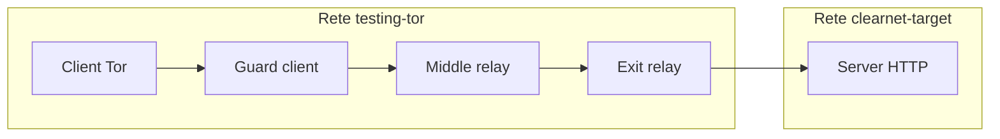
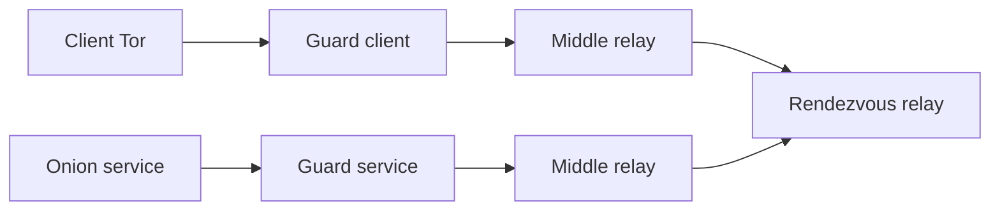

# (file da rivedere)
## Progetto Tor: correlazione in rete privata

Questo è il documento principale del progetto di gruppo, approvato dal
docente. Definisce la base comune, gli scenari, la divisione del lavoro e i
confini del laboratorio.

Per riprodurre prima le due prove di base, seguire
[`GETTING_STARTED.md`](GETTING_STARTED.md).

## Obiettivo

Costruire e usare una rete Tor privata su reti Docker dedicate per
confrontare la correlabilità statistica dei flussi in due casi:

1. un servizio HTTP clearnet interno raggiunto tramite exit relay;
2. un onion service raggiunto tramite rendezvous relay.

Gli esperimenti non coinvolgono la rete Tor pubblica. I risultati descrivono
questo laboratorio controllato e non sono direttamente generalizzabili alla
rete Tor reale.

## Struttura della repository

```text
docker/                         Immagine e configurazioni Tor comuni
cli/                            CLI per creare e gestire i container
shared-base/                    Base di laboratorio riusabile da tutti
  clearnet/scripts/             Prepara, verifica e pulisce il target HTTP
  onion/README.md               Procedura e confini dello scenario onion
experiments/
  clearnet-correlation/README.md Persona A: correlazione GuardClient–ExitRelay
  onion-correlation/README.md   Persona B: correlazione GuardClient–GuardService
  topology-comparison/README.md Possibile confronto tra scenari e topologie
docs/
  GETTING_STARTED.md            Setup e riproduzione delle due prove base
  PROJECT_PLAN.md               Obiettivo, ruoli e convenzioni
```

`shared-base/` contiene solo setup e prove comuni. `experiments/` contiene
invece gli script, le analisi e i risultati del singolo contributo. Prima di
iniziare il proprio esperimento, ogni componente deve riuscire a riprodurre
entrambi gli scenari con `GETTING_STARTED.md`.

## Modello di laboratorio

### Clearnet interno



Solo l'exit relay appartiene anche a `clearnet-target`; il client non può
raggiungere direttamente il server. Per il matching, i punti di osservazione
sono `GuardClient` ed `ExitRelay`.

### Onion service



Non esiste un exit relay. Per il matching, i punti di osservazione sono
`GuardClient` e `GuardService`. I log del container onion service sono
ground truth: servono a verificare i risultati, ma non sono dati disponibili
all'attaccante.

## Base comune

La rete Tor, la topologia e gli scenari devono restare riproducibili da zero.
La procedura condivisa comprende:

1. reset, build e avvio di directory authorities, relay ed exit relay;
2. attesa di un consensus che includa gli exit relay;
3. creazione del client SOCKS5;
4. prova onion service e prova clearnet interno;
5. pulizia delle sole risorse clearnet quando necessario.

I comandi e i controlli di salute sono in
[`GETTING_STARTED.md`](GETTING_STARTED.md). Le configurazioni che consentono
HTTP o destinazioni private sono destinate alla rete Docker del laboratorio.

## Contributi individuali

### Persona A — Correlazione entry–exit

Lavora in
[`experiments/clearnet-correlation/`](../experiments/clearnet-correlation/).

Genera traffico verso il server HTTP interno e confronta timing, burst,
direzione e quantità di byte osservati sul guard del client e sull'exit relay.

### Persona B — Correlazione client–onion service

Lavora in [`experiments/onion-correlation/`](../experiments/onion-correlation/).

Genera traffico verso l'onion service e confronta osservazioni sul guard del
client e sul guard del servizio. I log del servizio restano separati come
ground truth.

### Persona C — Proposta da confermare

Il piano attuale propone un confronto quantitativo tra scenari e topologie
in [`experiments/topology-comparison/`](../experiments/topology-comparison/).
Se il gruppo conferma la proposta, il contributo potrà riusare i risultati
delle parti clearnet e onion e studiare l'effetto di variazioni controllate,
come il numero di relay o la dimensione delle risposte HTTP.

## Dati, metriche e risultati

Le [convenzioni metodologiche condivise](METHODOLOGIES.md) descrivono dati,
unità e risultati da registrare per ogni run. Il riepilogo riporta le richieste
tentate e confermate, la copertura dei burst e delle richieste con i rispettivi
denominatori e, quando disponibile, il risultato del controllo.

Precision e recall richiedono etichette indipendenti per le associazioni
valutate. I log HTTP attestano le richieste e restano il riferimento a livello
di richiesta. Le cartelle `results/` degli esperimenti sono escluse da Git.

## Limiti del laboratorio

- Tutti i nodi sono eseguiti sulla stessa VM e condividono clock e rete.
- La topologia è piccola e interamente controllata dagli sperimentatori.
- I pattern risultano potenzialmente più facili da correlare rispetto alla
  rete Tor pubblica.
- Le conclusioni devono essere presentate come risultati sperimentali del
  laboratorio, non come valutazioni della sicurezza della rete Tor pubblica.

## Stato attuale

- La guida documenta le prove HTTP di base, sia onion via SOCKS5 sia clearnet
  via exit relay.
- Il contributo onion documenta cinque run da 100 richieste, con diario,
  notebook e [report sintetico](../experiments/onion-correlation/ONION_CORRELATION_MINIMAL.md).
- Il contributo clearnet ha completato la prova di connettività e la
  [verifica preliminare della raccolta dati](../experiments/clearnet-correlation/README.md#verifica-preliminare-della-raccolta-dati).
  La fase sperimentale quantitativa è da svolgere.
- Il terzo contributo è da confermare. Il confronto tra topologie resta
  l'ipotesi descritta nel piano.

## Consegna e report finale

Prima di scrivere o revisionare il report, consultare
[`main (1).pdf`](../../main%20%281%29.pdf), *Network Security: Project How-to*
di Leonardo Maccari. Le sezioni 1.1 e 1.2 descrivono i materiali e il formato
della consegna, la sezione 2.0.1 il tema Tor, la sezione 3 i criteri di
valutazione e la sezione 4 il modello del report.

La consegna prevede un PDF indicativamente di 5–10 pagine, esclusi gli
allegati, il codice sorgente se prodotto e un allegato che descriva i
contributi individuali. Per la discussione va preparata una demo del codice.
Il PDF del docente si trova nella cartella che contiene il repository.
Se si lavora da un clone separato, recuperarlo dai materiali del corso.
