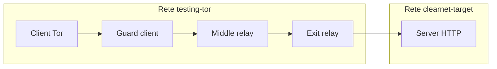
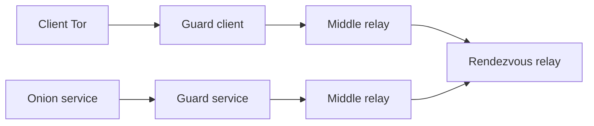

# (file da rivedere)
## Progetto Tor: correlazione in rete privata

Questo è il documento principale del progetto di gruppo, approvato dal
docente. Definisce la base comune, gli scenari, la divisione del lavoro e i
confini del laboratorio.

Per riprodurre prima le due prove di base, seguire
[`GETTING_STARTED.md`](GETTING_STARTED.md).

## Obiettivo

Costruire e usare una rete Tor privata, interamente isolata in Docker, per
confrontare la correlabilità statistica dei flussi in due casi:

1. un servizio HTTP clearnet interno raggiunto tramite exit relay;
2. un onion service raggiunto tramite rendezvous relay.

Gli esperimenti non coinvolgono la rete Tor pubblica. I risultati descrivono
questo laboratorio controllato e non sono direttamente generalizzabili alla
rete Tor reale.

## Struttura della repository

```text
docker/                         Immagine e configurazioni Tor comuni
cli/                            CLI per creare e gestire i container
shared-base/                    Base di laboratorio riusabile da tutti
  clearnet/scripts/             Prepara, verifica e pulisce il target HTTP
  onion/README.md               Procedura e confini dello scenario onion
experiments/
  clearnet-correlation/README.md Persona A: correlazione GuardClient–ExitRelay
  onion-correlation/README.md   Persona B: correlazione GuardClient–GuardService
  topology-comparison/README.md Persona C: confronto tra scenari e topologie
docs/
  GETTING_STARTED.md            Setup e riproduzione delle due prove base
  PROJECT_PLAN.md               Obiettivo, ruoli e convenzioni
```

`shared-base/` contiene solo setup e prove comuni. `experiments/` contiene
invece gli script, le analisi e i risultati del singolo contributo. Prima di
iniziare il proprio esperimento, ogni componente deve riuscire a riprodurre
entrambi gli scenari con `GETTING_STARTED.md`.

## Modello di laboratorio

### Clearnet interno



Solo l'exit relay appartiene anche a `clearnet-target`; il client non può
raggiungere direttamente il server. Per il matching, i punti di osservazione
sono `GuardClient` ed `ExitRelay`.

### Onion service



Non esiste un exit relay. Per il matching, i punti di osservazione sono
`GuardClient` e `GuardService`. I log del container onion service sono
ground truth: servono a verificare i risultati, ma non sono dati disponibili
all'attaccante.

## Base comune

La rete Tor, la topologia e gli scenari devono restare riproducibili da zero.
La procedura condivisa comprende:

1. reset, build e avvio di directory authorities, relay ed exit relay;
2. attesa di un consensus che includa gli exit relay;
3. creazione del client SOCKS5;
4. prova onion service e prova clearnet interno;
5. pulizia delle sole risorse clearnet quando necessario.

I comandi e i controlli di salute sono in
[`GETTING_STARTED.md`](GETTING_STARTED.md). Le configurazioni che consentono
HTTP o destinazioni private sono esclusivamente per questa rete Docker
isolata.

## Contributi individuali

### Persona A — Correlazione entry–exit

Lavora in
[`experiments/clearnet-correlation/`](../experiments/clearnet-correlation/).

Genera traffico verso il server HTTP interno e confronta timing, burst,
direzione e quantità di byte osservati sul guard del client e sull'exit relay.

### Persona B — Correlazione client–onion service

Lavora in [`experiments/onion-correlation/`](../experiments/onion-correlation/).

Genera traffico verso l'onion service e confronta osservazioni sul guard del
client e sul guard del servizio. I log del servizio restano separati come
ground truth.

### Persona C — Confronto quantitativo e impatto della topologia

Lavora in
[`experiments/topology-comparison/`](../experiments/topology-comparison/).

Confronta i due scenari variando, in modo controllato, numero di relay,
dimensione dei file, frequenza delle richieste, numero di circuiti o durata
delle sessioni. Riusa gli output degli esperimenti A e B invece di duplicarne
il matching.

## Dati, metriche e risultati

Quando inizierà la fase sperimentale, ogni run dovrà conservare separatamente:

- osservazioni disponibili all'attaccante;
- ground truth;
- configurazione della topologia;
- parametri del traffico e identificatore della sessione;
- risultato del matching.

Le metriche comuni minime sono:

- precision e recall;
- falsi positivi;
- percentuale di matching corretto;
- latenza e overhead;
- stabilità dei circuiti.

Le feature da considerare includono byte trasmessi, direzione, durata, burst e
intervalli temporali. I risultati derivati devono stare nelle cartelle
`results/` degli esperimenti, che non sono versionate.

Prima di implementare generatori di traffico, packet capture o matching, il
gruppo deve concordare un formato comune per metadati, feature e risultati:
questo è necessario affinché Persona C possa confrontare correttamente i due
scenari.

## Limiti del laboratorio

- Tutti i nodi sono eseguiti sulla stessa VM e condividono clock e rete.
- La topologia è piccola e interamente controllata dagli sperimentatori.
- I pattern risultano potenzialmente più facili da correlare rispetto alla
  rete Tor pubblica.
- Le conclusioni devono essere presentate come risultati sperimentali del
  laboratorio, non come valutazioni della sicurezza della rete Tor pubblica.

## Stato iniziale

- Rete Tor privata, CLI e immagini Docker funzionanti.
- Prova onion service verificata con richiesta HTTP tramite SOCKS5.
- Prova clearnet interna verificata con server HTTP che osserva l'exit relay
  come peer TCP.
- Packet capture, generazione controllata del traffico, analisi e matching non
  sono ancora implementati.

