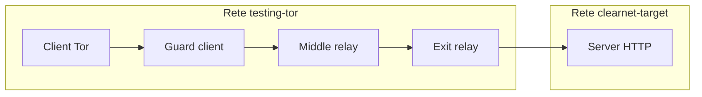
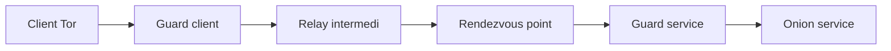
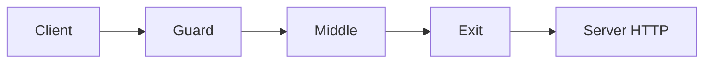

# Progetto Tor: correlazione in rete privata

Questo è il documento principale del progetto di gruppo. Descrive la base
comune, gli scenari, la divisione del lavoro e le attività ancora da svolgere.

## Collegamento alla prima prova

La prova iniziale e la procedura operativa per riprodurre gli scenari onion e
clearnet sono documentate in [`GETTING_STARTED.md`](GETTING_STARTED.md).

Questa fase riusa l'immagine, la CLI e la rete Tor preparate durante quella
prova.

## Struttura della repository

```text
docker/                         Immagine base Tor e template torrc
cli/                            CLI per la gestione dei container
experiments/clearnet/           Scenario clearnet interno
  scripts/prepare.sh            Crea rete target e server HTTP
  scripts/test.sh               Testa HTTP attraverso il SOCKS5
  scripts/cleanup.sh            Rimuove le risorse dello scenario
docs/GETTING_STARTED.md         Guida operativa e risultati delle prove
docs/PROJECT_PLAN.md            Piano principale del progetto
docs/UPSTREAM_NOTES.md          Provenienza e modifiche rispetto alla base
```

Per l'esecuzione rapida dello scenario clearnet, dopo avere creato la
topologia Tor di base:

```bash
source .venv311/bin/activate
./experiments/clearnet/scripts/prepare.sh
./experiments/clearnet/scripts/test.sh
```

## Obiettivo e modello di laboratorio

Costruire una rete Tor privata interamente in Docker e confrontare la
correlabilità dei flussi in due scenari controllati.

Scenario clearnet interno:



Scenario onion service:



- Nel caso clearnet interno, il client raggiunge un normale server HTTP
  attraverso guard, middle ed exit relay.
- Nel caso onion service, si confrontano le osservazioni sul `GuardClient` e
  sul `GuardService`.
- Il container onion service produce traffico e log di ground truth, ma non è
  una sorgente di dati dell'attaccante.
- Tutto resta nella VM Docker: non si effettuano attività sulla rete Tor
  pubblica.

## 1. Base comune riproducibile

- Creare un repository di gruppo che includa o tracci come dipendenza la base
  [`tor-testing-network`](../).
- Mantenere le modifiche del progetto in un branch o in una copia locale,
  registrando il commit upstream e le versioni Docker, Tor e Python.
- Organizzare il progetto in moduli semplici:

  ```text
  infra/                  rete e nodi Tor
  scenarios/clearnet/     scenario clearnet interno
  scenarios/onion/        scenario onion service
  capture/                raccolta packet capture e log
  analysis/               estrazione feature e matching
  docs/                   documentazione e risultati
  ```

- Fornire script ripetibili per build, avvio, attesa del consensus, reset e
  arresto.
- Documentare ruoli, IP, porte e comandi principali in un README destinato a
  tutti i componenti del gruppo.

## 2. Scenario clearnet interno

- Aggiungere una seconda rete Docker, `clearnet-target`, separata da
  `testing-tor`.
- Collegare solo gli exit relay a entrambe le reti.
- Mettere il server HTTP esclusivamente in `clearnet-target`, così client,
  guard e middle relay non possono raggiungerlo direttamente.
- Applicare una policy limitata all'ambiente di laboratorio. Il template
  attuale permette HTTP per consentire alle authorities di assegnare il flag
  `Exit`; il target sperimentale resta isolato nella rete Docker dedicata.
- Verificare una richiesta SOCKS end-to-end e controllare che il server osservi
  l'exit relay come peer TCP.

Flusso previsto:



## 3. Scenario onion service

- Riutilizzare l'onion service già validato nella prima prova.
- Generare un nuovo indirizzo `.onion` per ogni ambiente o esecuzione, quando
  necessario.
- Identificare un guard del client e un guard del servizio tramite log o
  control port.
- Catturare i dati osservabili dall'attaccante soltanto sui relay scelti:
  `GuardClient` e `GuardService`.
- Conservare gli access log dell'onion service esclusivamente come ground
  truth per valutare i risultati, separandoli dai dati usati dal matching.

## 4. Raccolta e analisi comune

- Standardizzare la generazione del traffico usando risorse di dimensione
  nota, numero di richieste, pause e identificatore della sessione.
- Eseguire più ripetizioni per ogni condizione sperimentale.
- Salvare packet capture, timestamp, metadati, configurazione e log in
  cartelle separate per ogni run.
- Estrarre almeno:
  - byte trasmessi;
  - pacchetti o celle osservabili;
  - direzione del traffico;
  - durata;
  - burst;
  - intervalli temporali.
- Usare metriche comuni:
  - latenza;
  - overhead;
  - precision;
  - recall;
  - falsi positivi;
  - percentuale di matching corretto.

## 5. Tre contributi individuali

### Persona A — Correlazione entry-exit

Eseguire il matching statistico tra `GuardClient` ed `ExitRelay` nello
scenario clearnet interno.

Il traffico viene generato verso un server HTTP normale nella subnet Docker.
Si confrontano timing, burst e quantità di byte osservati nei due punti.

### Persona B — Correlazione client-onion service

Eseguire il matching statistico tra `GuardClient` e `GuardService` nello
scenario onion.

I log dell'onion service vengono usati soltanto per la valutazione e per il
ground truth, non come osservazione dell'attaccante.

### Persona C — Confronto e impatto della topologia

Confrontare quantitativamente i due scenari variando, quando possibile:

- numero di relay;
- dimensione dei file;
- frequenza delle richieste;
- numero di circuiti;
- durata delle sessioni.

Misurare l'effetto sulla latenza, sull'overhead, sulla stabilità dei circuiti
e sul successo della correlazione.

## 6. Verifica, report e limiti

- Rendere ogni scenario rieseguibile da zero.
- Aggiungere un test di salute prima delle catture:
  consensus pubblicato, client con bootstrap al 100% ed endpoint raggiungibile.
- Preparare grafici e risultati dai dataset.
- Separare chiaramente:
  - osservazioni disponibili all'attaccante;
  - ground truth;
  - risultati del matching.
- Dichiarare i limiti del laboratorio:
  - tutti i nodi girano sulla stessa VM;
  - clock e rete sono condivisi;
  - la topologia è piccola;
  - i nodi sono controllati dagli sperimentatori;
  - i risultati non sono direttamente generalizzabili alla rete Tor pubblica.
- Chiedere conferma al docente sul modello di minaccia, sull'uso del
  clearnet interno e sul perimetro degli esperimenti prima dell'implementazione
  definitiva.

## Stato iniziale dell'implementazione

- La rete Tor privata di base è stata avviata e verificata.
- L'immagine Docker ARM64, la CLI Python e la rete `testing-tor` sono
  funzionanti.
- Lo scenario onion service è stato verificato con una richiesta HTTP via
  SOCKS5.
- Lo scenario clearnet interno è stato aggiunto in
  [`experiments/clearnet/`](../experiments/clearnet/), con script di
  preparazione, test e cleanup.
- La richiesta clearnet interna è stata verificata tramite SOCKS5; il server
  ha osservato l'indirizzo dell'exit relay come peer TCP.
- Le packet capture e gli script di analisi saranno aggiunti dopo la conferma
  del docente sul modello di minaccia e sull'ambito degli esperimenti.

