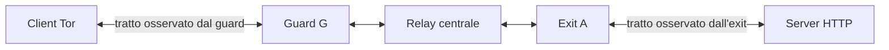

# Esperimento clearnet — piano e diario

Questo README è il riferimento di lavoro per la parte clearnet. Qui si
aggiornano il piano, le decisioni metodologiche e il diario delle prove.
La [bozza del report clearnet](CLEARNET_REPORT.md) usa queste note per
descrivere metodo, risultati e limiti.

L'esperimento studia la compatibilità temporale tra le osservazioni sul guard
del client e sull'exit relay durante richieste HTTP al server interno della
[rete Tor privata del laboratorio](../../shared-base/clearnet/).

## Primo run sperimentale

Preparare **la prima raccolta sperimentale** usando la topologia e il target
HTTP già verificati. La prova concordata prevede un solo run.

- Un client, un target HTTP e la stessa pagina per tutte le richieste.
- 100 richieste sequenziali. Tra la fine di un tentativo e l'inizio del
successivo, estrarre ogni volta una pausa casuale uniforme tra 2 e 5
secondi, come nel [generatore onion](../onion-correlation/traffic_generator.py).
- Un ID univoco per richiesta e log di client e server per verificare gli
esiti HTTP, come in `verifica_log_http`.
- I due tratti osservati sono il collegamento tra client e guard e quello
tra exit e server HTTP. Per ogni pacchetto osservato conservare il nodo
di osservazione, il timestamp Unix in secondi con la precisione originale,
la dimensione del frame in byte e la direzione rispetto al nodo.
Eventuali aggregazioni temporali si faranno durante l'analisi.

### Chi sceglie i nodi

Per questo run lasciamo che il software Tor del client scelga i circuiti.
Più richieste possono usare lo stesso circuito. La scelta che facciamo noi
riguarda i due container in cui misurare il traffico. Prima del run usiamo
lo stato dei circuiti del client per individuare un guard e un exit di
riferimento e ne annotiamo i nomi in `results/primo_run_sperimentale/setup.txt`.
Le due catture restano su quei container per tutta la prova. Dichiarare i
punti di misura lascia al client la libertà di usare anche altri circuiti.

Per esempio, supponiamo di osservare il guard G e l'exit A. Se la richiesta
37 usa G e A mentre entrambe le catture sono attive, i due tratti sono
osservabili. Se la 38 usa G e l'exit B, il server può riceverla regolarmente,
ma alla cattura su A manca il suo passaggio in uscita. Sapere che A era in
uso all'inizio del run non basta per decidere quale exit abbia usato la 38.
Perciò si conservano i riferimenti ai circuiti usati durante la prova e gli
intervalli di cattura. Quando i dati disponibili non permettono di stabilire
il percorso di una richiesta, si registra «visibilità sconosciuta».

### Come lo script coordinerà il run

1. **Prima della prima richiesta**, lo script sulla VM prepara il CSV del

   client e avvia un processo di cattura nel container del guard e uno nel
        container dell'exit. Attende che entrambi siano attivi. Ciascun processo
        resta in ascolto e scrive una traccia locale nel proprio container. Ogni
        pacchetto osservato riceve il timestamp del momento in cui passa. La
        registrazione è continua, anche tra due richieste, e non richiede che lo
        script interroghi Docker a intervalli regolari.
2. **Per ogni tentativo**, lo script assegna un ID univoco, annota l'ora

   di inizio e invia la richiesta via SOCKS5 con l'ID nell'URL. Alla risposta
        o all'errore registra l'ora di fine e salva subito una riga nel CSV con
        ID, tempi ed esito, come in `verifica_log_http`. Se resta una richiesta,
        attende la pausa casuale prima di iniziarla. Il server HTTP scrive nel
        proprio log l'ID e l'esito di ogni richiesta che riceve.
3. **Dopo il centesimo tentativo**, lo script ferma i due processi di

   cattura, attende la chiusura dei file e copia le tracce dai container
        alla cartella del run sulla VM. Qui raccoglie anche il log HTTP del server
        relativo alla prova, accanto al CSV del client. Copiare le tracce a fine
        run conserva i timestamp registrati durante il passaggio dei pacchetti.

### Parametri di riferimento

Per il confronto descrittivo si adotta la convenzione del
[report onion sintetico](../onion-correlation/ONION_CORRELATION_MINIMAL.md).

| Parametro | Valore | Significato |
|---|---:|---|
| Pausa massima interna al burst | 100 ms | Si misura tra pacchetti consecutivi dello stesso tratto e nella stessa direzione. Un cambio di direzione o una pausa superiore chiude il burst. |
| Dimensione minima del burst | Almeno 1.000 byte | Si sommano i byte dei frame già raggruppati nello stesso burst. Due frame da 600 e 400 byte raggiungono la soglia. Con 600 e 399 byte il burst rimane nella traccia ma è escluso dal confronto. |
| Finestra di compatibilità temporale | ±50 ms inclusi | Se un burst sul guard inizia a 1.000 ms dall'inizio del run, un burst sull'exit può essere candidato se inizia tra 950 e 1.050 ms. A 1.051 ms è fuori finestra. Ogni burst può contribuire a una sola coppia. |

La pagina HTTP è piccola e i due tratti trasportano traffico diverso.
Documentare quanti burst superano la soglia aiuta a interpretare il
risultato, anche se su uno dei lati ne restano pochissimi.

### Come leggere i risultati

- **Esiti HTTP.** Riportare tentativi, risposte HTTP 200 lato client,
ID distinti confermati dal server ed errori.
- **Copertura dei burst.** Per ciascun lato riportare quanti burst hanno
una coppia temporalmente compatibile sul totale dei burst valutati su
quel lato. Questa misura usa solo le osservazioni di rete.
- **Visibilità.** Fra le richieste confermate, contare come osservabili  
quelle per cui i nodi effettivamente usati erano entrambi sotto  
osservazione(perchè ci potrebero essere anche cambi di percorso) per tutto l'intervallo registrato dal client. Verificarlo  
con i dati sui circuiti e sugli intervalli di raccolta. Distinguere i  
cambi di percorso o le interruzioni accertate dai casi di visibilità  
sconosciuta. L'assenza di una coppia di burst, da sola, non indica una  
perdita di visibilità.
- **Copertura delle richieste.** Dopo aver individuato le coppie, usare
i log HTTP per la verifica. Una richiesta osservabile è coperta se gli
inizi di entrambi i burst di almeno una coppia cadono tra inizio e fine
della richiesta registrati dal client. Contarla una sola volta anche se
ci sono più coppie.

Per esempio, supponiamo che la richiesta 37 sia osservabile. A 100 ms
dall'avvio del run il client registra l'inizio del tentativo. Il server
risponde con HTTP 200 e invia la pagina. A 180 ms il client ha ricevuto
l'intera risposta e registra la fine del tentativo.
In una prima coppia, il burst sul guard inizia a 110 ms e quello sull'exit
a 120 ms. Entrambi gli inizi cadono nell'intervallo della richiesta, quindi
la 37 è coperta. Se una seconda coppia inizia a 150 ms sul guard e a 160 ms
sull'exit, il conteggio rimane **una richiesta coperta**. Se invece l'unica  
coppia iniziasse a 175 ms sul guard e a 185 ms sull'exit(dato che tra 

175 e 185 ci sono 10ms di differenza, i due burst rispettano la osglia di 50 ms 

e formano una coppia candidata), la 37 resterebbe  
scoperta perché il secondo burst comincia dopo la fine della richiesta.

I log attestano la richiesta e il suo esito. L'attribuzione
dei burst alla richiesta resta un'ipotesi basata sui tempi.

Nel riepilogo presentare i conteggi di richieste confermate, osservabili
e coperte. Riportare la visibilità (osservabili/confermate), la copertura
complessiva (coperte/confermate) e quella tra le osservabili
(coperte/osservabili). Se un denominatore è zero, indicare «non calcolabile».
Per esempio, con 100 confermate, 90 osservabili e 60 coperte, i rapporti
sono rispettivamente 90/100, 60/100 e 60/90.

Per il confronto con onion indicare sia i tratti osservati sia la definizione
della finestra di richiesta. Qui vale l'intervallo effettivo del client,
senza margine aggiunto. La finestra di ±50 ms in tabella riguarda invece
la distanza tra gli inizi dei burst.

## Piano

### Completato

- [x] Verificare la connettività verso il target HTTP via SOCKS5.
- [x] Verificare con cinque richieste che gli ID colleghino i log di client e server.
- [x] Salvare l'inventario dei container in `primo_run_sperimentale/setup.txt`.
- [x] Definire il carico del primo run, i dati da raccogliere e le misure di copertura.
- [x] Implementare il [generatore HTTP e il riepilogo dei log](http_run.py)
  e verificare il riepilogo sui dati preliminari. Il comando `summary` legge
  file esistenti, mentre `generate` avvia traffico reale.

### Prima del run

- [ ] Completare il coordinatore della raccolta per la singola coppia client–server
  e verificarne il funzionamento offline.
- [ ] Prima dell'avvio, registrare nella scheda del run la configurazione
  effettiva e i due punti di osservazione.

### Esecuzione su conferma esplicita

- [ ] Avviare il run da 100 richieste solo dopo la conferma esplicita di chi conduce la prova.
  Conservare nella cartella del run il CSV del client, il log del server,
  le tracce e gli intervalli effettivi di raccolta.

### Dopo il run

- [ ] Verificare che il CSV contenga una riga per tentativo. Contare le
  risposte HTTP 200, gli errori e gli ID confermati dal server. Segnalare ID
  mancanti o duplicati.
- [ ] Verificare la visibilità dei due tratti durante le richieste. Annotare
  eventuali cambi di circuito, interruzioni e intervalli di visibilità incerta.
- [ ] Valutare la compatibilità temporale delle tracce. Riportare la copertura
  dei burst e delle richieste con i rispettivi numeratori e denominatori,
  secondo le [convenzioni metodologiche](../../docs/METHODOLOGIES.md).
- [ ] Riportare metodo, risultati e limiti nella [bozza clearnet](CLEARNET_REPORT.md),
  seguendo le [indicazioni per il report finale](../../docs/PROJECT_PLAN.md#consegna-e-report-finale).

## Diario

### Verifica preliminare della raccolta dati

- **19 novembre 2026 ·** `verifica_log_http`**.** Cinque richieste HTTP sequenziali
inviate via SOCKS5 al server interno, con un `request_id` univoco nell'URL.
- **Esito.** Cinque risposte HTTP 200 lato client. Ogni ID compare una volta
nel log del server, con HTTP 200.
- **Cosa verifica.** Il controllo conferma che gli stessi ID permettono di
riconciliare i due log HTTP a livello di richiesta.
- **File.** `results/verifica_log_http/setup.txt`, `client_requests.csv` e
`server.log` nella stessa cartella. Il CSV e il log conservano gli ID
originali delle richieste. I dati grezzi sono locali a `results/`, che Git
ignora.

### Controllo prima del primo run sperimentale

- **20 novembre 2026.** Docker mostra gli stessi container di
`verifica_log_http` in esecuzione. La topologia comprende 3 directory
authority, 5 relay, 3 exit relay, 1 client Tor e 1 server HTTP.
- **Esito.** Una richiesta attraverso SOCKS5 su `127.0.0.1:9050` al target
`172.30.0.10:80` ha restituito la pagina «Private clearnet target».

### Preparazione di `primo_run_sperimentale`

- **20 novembre 2026.** Salvato l'elenco dei container attivi in
`results/primo_run_sperimentale/setup.txt`. I nomi coincidono con quelli di
`verifica_log_http`.
- **Stato.** La cartella del run contiene l'inventario Docker. L'invio
delle richieste e la raccolta sperimentale sono da svolgere.
- **Ripristino dopo il riavvio della VM.** Riavviati i container Tor
esistenti e il server HTTP. Il test di connettività via SOCKS5 ha
restituito di nuovo la pagina «Private clearnet target».
- **Contatori Docker facoltativi.** `contatori_prima.txt` contiene i
byte cumulativi ricevuti e inviati dai container al momento della
lettura. Per riportare il volume complessivo di un run, salvare una
lettura subito prima e una subito dopo, quindi calcolare la differenza
per container. Il volume include il traffico di fondo. Ha senso citarlo
nel report come misura accessoria del carico di rete. Per la correlazione
temporale servono osservazioni con un riferimento temporale.

### Decisioni di lavoro

- La verifica HTTP preliminare è conclusa. Lo script dedicato a ripeterla
è stato rimosso.
- L'eventuale confronto con onion resta da concordare con il gruppo. Per
il confronto va indicata la tabella onion di riferimento e vanno annotate
le differenze tra le condizioni delle prove.

Per ogni prossimo run, aggiungere qui data e ID, configurazione effettiva,
esito, anomalie e percorso dei file locali. Registrare anche le decisioni di
sviluppo che incidono sulle misure o sulla loro riproducibilità.

## Riferimenti

- [Guida clearnet](../../docs/GETTING_STARTED.md#prova-clearnet-interna)
per l'avvio del target e la verifica HTTP.
- [Report onion sintetico](../onion-correlation/ONION_CORRELATION_MINIMAL.md)
per un esempio di presentazione di risultati, controllo e limiti.
- [Report onion completo](../onion-correlation/ONION_CORRELATION_REPORT.md),
sezioni 4 e 6, per il dettaglio delle misure e dei limiti.

## Estensione opzionale di de-anonimizzazione del traffico con più client e server

Dopo aver completato e documentato il primo esperimento con una sola coppia  
client–server, se resta tempo valuteremo con il gruppo questa domanda:  
quando più client comunicano contemporaneamente con più server, le  
osservazioni permettono di distinguere quale client ha contattato quale server?  
Se decidiamo di procedere, prima della prova aggiungeremo qui un breve piano  
con lo scenario, i dati da raccogliere e il criterio di valutazione.  
Per interpretare le coincidenze temporali ripetute, il piano dovrebbe  
prevedere anche un controllo su coppie client–server che, secondo i log  
del laboratorio, non hanno comunicato tra loro. Il confronto servirà a  
valutare quanto spesso un'associazione errata appaia comunque plausibile.

## (è solo un esempio) Guida visiva al primo run

Gli esempi usano tempi inventati, in millisecondi dall'inizio del run.

### 1. Dove si misura il tempo



Il **client** dà l'intervallo della richiesta, dall'avvio del tentativo alla
ricezione dell'intera risposta in caso di successo. Il **server** conferma
l'arrivo tramite l'ID. Il **guard** e l'**exit** forniscono ciascuno una
traccia di rete. La soglia di 50 ms confronta gli inizi dei burst **sul guard
e sull'exit**. Il tempo misurato dal client entra in gioco dopo, per la copertura.

### 2. Come leggere una singola traccia

```text
Tempo sul guard       110 ms           115 ms                    230 ms
Frame osservati       → 600 byte       → 450 byte                → 300 byte
                            └── 5 ms ──┘       └──── 115 ms ─────┘
                      └──── burst 1 ────────┘                    burst 2
                             1.050 byte                          300 byte
```

Le frecce indicano la direzione rispetto al nodo. I primi due frame hanno
la stessa direzione e distano 5 ms, quindi stanno nello stesso burst. Il
terzo arriva dopo una pausa superiore a **100 ms** e apre un altro burst.
Anche un cambio di direzione aprirebbe un nuovo burst. La soglia di
**1.000 byte** si applica al totale del gruppo. In questo esempio il primo
burst passa il filtro, il secondo resta nella traccia ma è troppo piccolo
per il confronto. La stessa lettura si fa separatamente sull'exit.

### 3. Quando una richiesta conta come coperta

La richiesta 37 è confermata dal server. Il client la avvia a **100 ms**
e finisce di ricevere la pagina a **180 ms**. Supponiamo che i due tratti
siano osservabili. I casi A, B e C sono tre alternative per la stessa richiesta.
Ogni punto indica **l'inizio di un burst** che ha superato la soglia in byte.

```text
Tempo (ms)       100       120       140       160       180  190
Client           [───────────────────────────────────────]
Caso A · guard        ●
Caso A · exit              ●
Caso B · guard                                         ●
Caso B · exit                                               ●
Caso C · guard        ●
Caso C · exit                                       ●
```

| Caso | Distanza guard–exit | Entrambi gli inizi dentro [100, 180] ms? | Esito per la richiesta 37 |
|---|---:|---|---|
| A · 110 e 120 ms | 10 ms | Sì | Coperta. Anche con una seconda coppia valida, conta una sola volta. |
| B · 175 e 185 ms | 10 ms | No, 185 ms supera 180 ms | Scoperta se questa è l'unica coppia. |
| C · 110 e 170 ms | 60 ms | Sì | Scoperta se questi sono gli unici burst. La distanza supera 50 ms, quindi non formano una coppia. |

### 4. Se cambia il percorso

Immagina **tre richieste**, tutte confermate dal server. Le catture sono sul
guard G e sull'exit A per tutta la prova.

| Richiesta | Percorso effettivo | Cosa puoi concludere |
|---|---|---|
| 37 | Passa per G e A | Osservabile. Con i tempi del caso A è anche coperta. |
| 38 | Passa per G e A | Osservabile. Con i tempi del caso B resta scoperta. |
| 39 | Passa per G e un altro exit | Il secondo tratto è fuori dalla cattura su A. La richiesta resta tra le confermate. |

Il riepilogo è **3 confermate → 2 osservabili → 1 coperta**. La copertura è
**1/3** su tutte le confermate e **1/2** tra quelle osservabili. Se il percorso
della 39 fosse ignoto, si annoterebbe «visibilità sconosciuta». Il solo fatto
di non trovare una coppia non permette di stabilire che sia cambiato l'exit.
