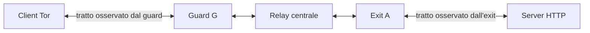

# Esperimento clearnet — piano e diario

Questo README è il riferimento di lavoro per la parte clearnet. Qui si aggiornano il piano, le decisioni metodologiche e il diario delle prove. L'analisi dei run e i testi di base per il report sono nel [notebook clearnet](clearnet_analysis.ipynb), che rimanda qui per le motivazioni delle scelte.

L'esperimento studia la compatibilità temporale tra le osservazioni sul guard del client e sull'exit relay durante richieste HTTP al server interno della [rete Tor privata del laboratorio](../../shared-base/clearnet/).

## Raccolta sperimentale

La raccolta comprende **5 run da 100 richieste**. Tutti i run usano la topologia e il target HTTP già verificati. Più run permettono il [controllo della casualità](#controllo-della-casualità) e aumentano la probabilità di osservare un cambio di circuito durante la prova. Il disegno è lo stesso dell'[esperimento onion](../onion-correlation/ONION_CORRELATION_MINIMAL.md), quindi i risultati si possono confrontare.

- Un client, un target HTTP e la stessa pagina per tutte le richieste: un file da **10 KB** (`/10k.bin`, 10.000 byte casuali). La pagina di prova attuale è di circa 30 byte e sul tratto exit–server non produrrebbe burst da almeno 1.000 byte. La dimensione coincide con il file `10k.bin` usato da Sebastiano nello scenario onion.
- In ogni run, 100 richieste sequenziali. Tra la fine di un tentativo e l'inizio del successivo, estrarre ogni volta una pausa casuale uniforme tra 2 e 5 secondi, come nel [generatore onion](../onion-correlation/traffic_generator.py). Un run dura circa 6 minuti, i 5 run circa 35 minuti.
- Un ID univoco per richiesta e log di client e server per verificare gli esiti HTTP, come in `verifica_log_http`.
- La configurazione di Tor resta quella di default. Non si fissano guard ed exit e conflux resta attivo (Tor 0.4.9.11 nell'immagine del laboratorio). Le motivazioni sono nelle [scelte metodologiche](#scelte-metodologiche-e-motivazioni).
- Durante ogni run si cattura il traffico di **tutti i relay** della rete: 3 directory authority, 5 relay e 3 exit. Per ogni pacchetto si conservano il nodo di osservazione, il timestamp Unix in secondi con la precisione originale, la dimensione del frame in byte, gli IP, le porte e la direzione rispetto al nodo. Eventuali aggregazioni temporali si faranno durante l'analisi.

Con conflux il percorso fra client ed exit si sdoppia su due guard. Spiegazione ed esempio con schema in fondo alla pagina: [come funziona conflux nel laboratorio](#come-funziona-conflux-nel-laboratorio).

### Quali nodi osserviamo

Il software Tor del client sceglie liberamente i circuiti. Più richieste possono usare lo stesso circuito e, durante un run, il guard o l'exit possono cambiare. Per questo si cattura su tutti i relay. Sugli stessi dati l'analisi si fa poi da due punti di vista.

**Analisi sul percorso effettivo.** Ogni richiesta si valuta con il guard e l'exit che ha usato davvero:

- **exit:** quello il cui IP compare nel log del server per l'ID della richiesta;
- **guard:** il relay che, nell'intervallo della richiesta, ha scambiato più byte con il client. Il log del client non basta, perché con conflux indica solo una delle due gambe ([come funziona conflux](#come-funziona-conflux-nel-laboratorio)).

Per ogni combinazione guard–exit usata nel run si abbinano i burst delle due tracce. Una richiesta è coperta se una coppia della sua combinazione cade nel suo intervallo. È la stessa misura che darebbe un esperimento con guard ed exit fissati, calcolata su tutte le richieste confermate. È il risultato principale e quello da confrontare con onion.

**Analisi sui nodi osservati.** Un attaccante reale controlla pochi nodi e non sceglie quali richieste vedere. Questa analisi lo rappresenta. A fine run, separatamente per ciascun run, si considerano osservati:

- **guard osservato:** il relay che nel run ha scambiato più byte con il client, contando solo i pacchetti tra quel relay e l'IP del client;
- **exit osservato:** l'exit che nel run ha scambiato più byte con il server `172.30.0.10`, contando solo i pacchetti tra l'IP dell'exit sulla rete `clearnet-target` e il server. Il log del server conferma il dato, perché registra come peer TCP l'IP dell'exit che ha inoltrato ogni richiesta.

Si analizzano solo le tracce di questi due nodi, come farebbe un attaccante che controlla quei due relay. Le richieste passate da altri nodi gli sfuggono, e la [visibilità](#7-si-misura-la-visibilità-delle-richieste) misura quante sono. Si contano i byte del solo collegamento con il client e del solo collegamento con il server, non il traffico totale del relay. Si contano solo i pacchetti che hanno come estremi l'IP del nodo e quello del client, o del server: il bridge Docker a volte copia su un nodo pacchetti destinati ad altri. Il motivo è nella [scelta 2](#2-cattura-su-tutti-i-relay-e-scelta-dei-nodi-osservati-a-fine-run).

I due tratti analizzati, in entrambe le analisi, sono:

- **lato guard:** i pacchetti tra il guard e il client, sulla porta 9001;
- **lato exit:** i pacchetti tra l'exit e il server `172.30.0.10:80`, sulla rete `clearnet-target`.

Le catture conservano anche il resto del traffico dei relay, compreso il collegamento guard–middle e quello degli exit sulla porta 9001. Questi dati restano disponibili per verifiche aggiuntive. La scelta dei tratti e la differenza dall'analisi onion sono motivate nella [scelta 8](#8-tratti-analizzati).

**Visibilità.** Nell'analisi sui nodi osservati, una richiesta confermata è osservabile se è passata dal guard osservato e dall'exit osservato. È una classificazione di chi conduce l'esperimento, mentre l'attaccante vede solo le tracce dei nodi che osserva. Per ogni richiesta lo si verifica così:

| Nodo | Come si verifica | Fonte |
|---|---|---|
| Exit | L'IP del peer registrato per quell'ID è quello dell'exit osservato | Log del server |
| Guard | Nell'intervallo della richiesta il guard osservato ha scambiato con il client almeno una cella di dati (frame da almeno 100 byte, non solo conferme TCP) | Cattura sul guard osservato |

**Conflux.** Durante la stessa richiesta il client può scambiare traffico con due guard. Nell'analisi sul percorso effettivo la richiesta si valuta con il guard che ha scambiato più byte. Nell'analisi sui nodi osservati è osservabile se il guard osservato ha scambiato con il client almeno una cella di dati nel suo intervallo, qualunque cosa contenga. In entrambe le analisi si conta a parte quante richieste hanno avuto celle di dati su due guard: per queste un attaccante su un solo guard vede solo una parte dello scambio, a volte troppo poca per correlarla ([come funziona conflux](#come-funziona-conflux-nel-laboratorio)).

Il coordinatore registra anche i circuiti del client tramite la ControlPort. Servono come controllo incrociato e per riportare i cambi di circuito e l'uso di conflux. Si registra «visibilità sconosciuta» solo quando un dato manca, per esempio se una cattura si interrompe.

Per esempio, supponiamo che a fine run il guard G e l'exit A risultino i nodi con più byte. La richiesta 37 passa per G e A ed è osservabile. La 38 passa per G e per l'exit B. Il server la riceve regolarmente, ma l'attaccante che osserva A non la vede, quindi la 38 non è osservabile. L'IP dell'exit nel log del server permette di distinguere i due casi. Nell'analisi sul percorso effettivo, invece, la 38 si valuta con le tracce di G e di B.

### Come lo script coordinerà ogni run

1. **Preparazione, una volta sola.** Creare `/srv/10k.bin` nel container `clearnet-target-web` se manca. Lo script di base [`prepare.sh`](../../shared-base/clearnet/scripts/prepare.sh), che crea il server e la rete `clearnet-target`, non va modificato. Installare `tshark` sulla macchina che esegue lo script. Si usa solo per convertire i pcap, quindi non servono i permessi di cattura per utenti non root.
2. **Prima della prima richiesta.** Lo script legge dalla rete Docker l'elenco dei relay con i loro IP, su entrambe le reti per gli exit (perché gli exit sono gli unici collegati a due reti Docker), e crea la cartella del run. Una cartella esistente non viene mai sovrascritta.
   - Avvia `tcpdump -i any -nn -s 0 -U` in ogni relay. Sulle directory authority e sui relay il filtro è `tcp port 9001`. Sugli exit il filtro è `tcp port 9001 or host 172.30.0.10`. Non si usa `tcp port 80`, perché è anche la DirPort delle directory authority e catturerebbe il traffico delle directory.
   - Avvia nel container del client un registratore degli eventi `CIRC` e `STREAM` di Tor tramite la ControlPort (libreria `stem`, già presente nell'immagine). Ogni evento viene scritto con il proprio timestamp. Gli eventi `STREAM` indicano il circuito usato da ciascuna connessione verso `172.30.0.10:80`. Gli eventi `CIRC` indicano il percorso del circuito e l'eventuale scopo conflux.
   - Verifica che tutte le catture e il registratore siano attivi, poi attende 5 secondi.
3. **Per ogni tentativo.** Come in `http_run.py generate`, con la pagina `/10k.bin`. Lo script assegna un ID univoco, annota l'ora di inizio e invia la richiesta via SOCKS5 con l'ID nell'URL. Alla risposta o all'errore registra l'ora di fine e salva subito la riga nel CSV. Se resta una richiesta, attende la pausa casuale prima di iniziarla.
4. **Dopo l'ultimo tentativo.** Lo script attende 5 secondi e poi:
   - ferma tutte le catture con SIGINT, anche in caso di errore o di interruzione manuale;
   - ferma il registratore dei circuiti;
   - copia i pcap nella cartella del run e li cancella dai container. Gli eventi dei circuiti arrivano già nella cartella del run durante la registrazione;
   - salva il log del server relativo al run;
   - con `tshark` converte ogni pcap in CSV (`frame.time_epoch`, `frame.len`, `ip.src`, `ip.dst`, `tcp.srcport`, `tcp.dstport`) e lo ritaglia alla finestra tra la prima richiesta meno 5 s e l'ultima più 5 s.
5. **Scheda del run.** Lo script scrive `run_info.json` con:
   - parametri, container e IP;
   - versione di Tor;
   - intervalli effettivi di cattura;
   - contatori di tcpdump;
   - eventuali avvisi, per esempio pacchetti persi o richieste non confermate.

Lo script va nella cartella di questo esperimento. Riusa le idee già collaudate in [`run_experiment.py`](../topology-comparison/run_experiment.py) di Sebastiano: avvio e stop sicuro di tcpdump, finestra di ±5 s e cartelle mai sovrascritte.

### Parametri di riferimento

Per il confronto con onion si adottano i parametri del [report onion sintetico](../onion-correlation/ONION_CORRELATION_MINIMAL.md).

| Parametro | Valore | Significato |
|---|---:|---|
| Pausa massima interna al burst | 100 ms | Si misura tra pacchetti consecutivi dello stesso tratto e nella stessa direzione. Un cambio di direzione o una pausa superiore chiude il burst. |
| Dimensione minima del burst | Almeno 1.000 byte | Si sommano i byte dei frame già raggruppati nello stesso burst. Due frame da 600 e 400 byte raggiungono la soglia. Con 600 e 399 byte il burst rimane nella traccia ma è escluso dal confronto. |
| Finestra di compatibilità temporale | ±50 ms inclusi | Se un burst sul guard inizia a 1.000 ms dall'inizio del run, un burst sull'exit può essere candidato se inizia tra 950 e 1.050 ms. A 1.051 ms è fuori finestra. Ogni burst può contribuire a una sola coppia, scelta come la più vicina tra quelle disponibili. |
| Margine della finestra di richiesta | ±50 ms | Una richiesta è coperta se l'inizio del burst sul guard di almeno una coppia cade tra l'inizio della richiesta meno 50 ms e la fine più 50 ms. È la stessa definizione dell'analisi onion. |

Con la pagina da 10 KB ogni risposta dovrebbe produrre sul tratto exit–server almeno un burst sopra la soglia. La risposta può spezzarsi in più burst, perché anche gli ACK TCP cambiano direzione e chiudono il burst, come nell'analisi onion. Documentare quanti burst superano la soglia su ciascun lato aiuta a interpretare il risultato.

### Controllo della casualità

Una percentuale di coppie, da sola, non dice se i burst del guard e dell'exit sono legati dalla stessa richiesta. Con un burst ogni pochi secondi, due inizi possono cadere entro 50 ms anche per caso. Il controllo ripete lo stesso identico abbinamento in una situazione in cui un legame vero non può esistere e misura quante coppie si formano lo stesso.

Il controllo è **cross-run**, come nell'analisi onion. I burst del guard del run *i* si abbinano ai burst dell'exit di un altro run *j*. La traccia di *j* si trasla in modo che la prima richiesta dei due run coincida. Il run *j* è avvenuto in un altro momento, quindi nessuna coppia può essere vera. Per il run *i* si riporta la media sugli altri 4 run. Con un solo run questo controllo non sarebbe possibile. Nell'analisi sul percorso effettivo, per ogni combinazione guard–exit si usa la traccia dello stesso exit nel run *j*. Si cattura su tutti i relay, quindi è sempre disponibile. Se però in *j* quell'exit non fosse stato usato, la sua traccia verso il server sarebbe vuota e il controllo varrebbe zero per costruzione. Nei 5 run il caso non si presenta, perché tutte le richieste sono passate da `exitvaqtnywn`; nel report va dichiarato.

Il risultato è il **divario tra reale e controllo**. Nell'analisi onion le richieste coperte sono l'85,8% nei dati reali contro il 3,1% nel controllo.

### Come leggere i risultati

- **Esiti HTTP.** Per ogni run riportare tentativi, risposte HTTP 200 lato client, ID distinti confermati dal server ed errori.
- **Percorsi.** Per ogni run riportare quante richieste hanno usato ciascun guard e ciascun exit, quante volte sono cambiati e quante richieste hanno avuto celle di dati su due guard (conflux). Riportare anche il guard e l'exit osservati.
- **Copertura dei burst.** Per ciascun lato riportare quanti burst hanno una coppia temporalmente compatibile sul totale dei burst valutati su quel lato. Nell'analisi sui nodi osservati si usano le loro due tracce. Nell'analisi sul percorso effettivo si usa ciascuna combinazione guard–exit. Accanto riportare lo stesso valore nel controllo. Questa misura usa solo le osservazioni di rete.
- **Visibilità.** Solo nell'analisi sui nodi osservati. Fra le richieste confermate, contare come osservabili quelle passate sia dal guard osservato sia dall'exit osservato. Il dato viene dall'IP dell'exit nel log del server e dalla cattura sul guard osservato, con i circuiti registrati come controllo incrociato. Distinguere i cambi di percorso accertati dai casi di visibilità sconosciuta. L'assenza di una coppia di burst, da sola, non indica una perdita di visibilità.
- **Copertura delle richieste.** Dopo aver individuato le coppie, usare i log HTTP per la verifica. Una richiesta è coperta se l'inizio del burst sul guard di almeno una coppia cade nell'intervallo [inizio − 50 ms, fine + 50 ms] registrato dal client. Contarla una sola volta anche se ci sono più coppie. Nell'analisi sul percorso effettivo valgono le coppie della combinazione guard–exit usata dalla richiesta. Nell'analisi sui nodi osservati valgono le coppie dei due nodi osservati. Calcolare la stessa misura nel controllo.

Per esempio, supponiamo che la richiesta 37 sia osservabile. A 100 ms dall'avvio del run il client registra l'inizio del tentativo. Il server risponde con HTTP 200 e invia la pagina. A 180 ms il client ha ricevuto l'intera risposta e registra la fine del tentativo. La finestra della richiesta con il margine va quindi da 50 a 230 ms. In una prima coppia, il burst sul guard inizia a 110 ms e quello sull'exit a 120 ms. L'inizio sul guard cade nella finestra, quindi la 37 è coperta. Se una seconda coppia inizia a 150 ms sul guard e a 160 ms sull'exit, il conteggio rimane **una richiesta coperta**. Se invece l'unica coppia iniziasse a 240 ms sul guard e a 250 ms sull'exit, la 37 resterebbe scoperta. I due burst distano solo 10 ms e formano una coppia valida, ma il burst sul guard comincia dopo i 230 ms della finestra.

I log attestano la richiesta e il suo esito. L'attribuzione dei burst alla richiesta resta un'ipotesi basata sui tempi.

Nel riepilogo presentare, per run e in totale:

- **analisi sul percorso effettivo:** richieste confermate e coperte, e la copertura (coperte/confermate);
- **analisi sui nodi osservati:** richieste confermate, osservabili e coperte, la visibilità (osservabili/confermate), la copertura complessiva (coperte/confermate) e quella tra le osservabili (coperte/osservabili).

Accanto alle coperture riportare i valori del controllo. Se un denominatore è zero, indicare «non calcolabile». Per esempio, con 100 confermate, 90 osservabili e 60 coperte, i rapporti sono rispettivamente 90/100, 60/100 e 60/90.

Per il confronto con onion si usa la copertura dell'analisi sul percorso effettivo, che corrisponde al caso in cui l'attaccante osserva davvero i nodi usati. Va comunque indicato quali tratti si osservano in ciascuno scenario.

## Scelte metodologiche e motivazioni

Questa sezione raccoglie il ragionamento dietro le scelte principali, da riportare nel report finale.

### 1. Guard ed exit non vengono fissati

**In breve.** Il client resta nella configurazione di default di Tor. Catturando su tutti i relay non si perde la misura che darebbe un esperimento con i nodi fissati, cioè l'analisi sul percorso effettivo. In più si osserva il comportamento reale di Tor.

- **Fissare i nodi richiede un client modificato.** Servirebbero `EntryNodes`, `ExitNodes`, `StrictNodes` e conflux disattivato. Un client così non ruota gli exit e non usa conflux, quindi non si comporta come un client Tor normale.
- **Si misura la correlazione nelle condizioni reali di funzionamento.** La rotazione dei circuiti (circa ogni 10 minuti, `MaxCircuitDirtiness`) e conflux restano attivi. Se influiscono sulla correlazione, l'effetto entra nei dati invece di restare nascosto.
- **Non si perde nulla rispetto ai nodi fissati.** L'analisi sul percorso effettivo valuta ogni richiesta con i nodi che ha usato davvero. È la stessa misura dell'esperimento con nodi fissati, sulle stesse richieste. Fanno eccezione le richieste divise da conflux su due guard, che si contano a parte.
- **In più si vede la rotazione.** L'analisi sui nodi osservati mostra cosa perde un attaccante che controlla un solo guard e un solo exit mentre i circuiti cambiano.

**Obiezione: il laboratorio ha solo 3 exit.** È vero. La rete reale ne ha più di mille e li sceglie in proporzione alla banda, quindi la quota di richieste che sfugge all'attaccante nel laboratorio non stima la situazione reale. Per questo la visibilità si presenta come descrizione del laboratorio, per esempio «in 35 minuti i circuiti sono cambiati N volte», e non come stima. La probabilità che l'attacco riesca si scompone così:

> P(attacco riesce) = P(attaccante in posizione) × P(correlazione funziona | attaccante in posizione)

Il laboratorio misura il secondo fattore con l'analisi sul percorso effettivo. Il primo dipende dalle dimensioni della rete reale e si discute nel report con i dati pubblici di Tor.

### 2. Cattura su tutti i relay e scelta dei nodi osservati a fine run

Guard ed exit possono cambiare durante un run. Il guard cambia per esempio con conflux, l'exit con la rotazione dei circuiti. Catturare su tutti i relay costa poco e garantisce di avere il traffico di ogni richiesta. Nell'analisi sui nodi osservati, a fine run si considerano osservati il guard che ha scambiato più byte con il client e l'exit che ha scambiato più byte con il server.

- **Perché è difendibile.** Rappresenta lo scenario più favorevole all'attaccante: controlla il nodo di entrata e quello di uscita attraverso cui passa la maggior parte del traffico del client. I risultati sono quindi un limite superiore per questo laboratorio.
- **Perché i byte del solo collegamento con il client o con il server.** Il traffico totale di un relay comprende gli altri circuiti e il traffico delle directory, che pesa soprattutto sulle directory authority. Il relay con più traffico totale potrebbe quindi essere una directory authority che le richieste dell'esperimento non hanno mai attraversato. I byte scambiati con l'IP del client, o con il server, sono invece solo traffico del client. La scelta usa direttamente le catture, senza bisogno di ricostruire i circuiti.
- **Limite da dichiarare.** Un attaccante reale non sceglie i nodi a posteriori conoscendo i percorsi. La scelta usa la ground truth e va presentata come caso favorevole all'attaccante. L'analisi sul percorso effettivo completa il quadro, valutando ogni richiesta con i nodi che ha usato davvero.

### 3. Conflux resta attivo

Conflux è attivo di default da Tor 0.4.8. Il client può costruire due circuiti che partono da guard diversi e arrivano allo stesso exit, e può dividere il traffico tra i due. Per coerenza con la scelta 1 non lo si disattiva. La cattura su tutti i relay e la registrazione dei circuiti mostrano se e quanto conflux venga usato. Nell'analisi sul percorso effettivo una richiesta si valuta con il guard che ha scambiato più byte con il client nel suo intervallo. Si riporta quante richieste hanno avuto celle di dati su due guard: per queste un attaccante su un solo guard vede solo una parte dello scambio.

### 4. Pagina da 10 KB e soglia di 1.000 byte

La soglia di 1.000 byte resta quella dell'analisi onion. Con la pagina attuale di circa 30 byte, sul tratto exit–server, cioè HTTP in chiaro, nessun burst raggiungerebbe la soglia. Una pagina da 10 KB produce invece un burst di risposta ben sopra la soglia.

- **Effetto sul confronto con onion.** Elena usava una pagina di pochi byte (`Hello Tor`) e osservava due guard, dove il traffico viaggia in celle Tor da circa 500 byte. Una pagina più grande produce burst più grandi e più numerosi, quindi più richieste superano la soglia. Nel suo report tutte le 71 richieste scoperte su 500 lo sono proprio per la soglia di 1.000 byte (sezione 4.5 del [report onion](../onion-correlation/ONION_CORRELATION_REPORT.md)).
- **Da dichiarare nel report.** Una copertura clearnet più alta di quella onion può dipendere in parte dalla pagina e non dallo scenario. La stessa pagina usata in entrambi gli scenari renderebbe il confronto diretto. Lo scenario onion offre già il file `10k.bin` (`shared-base/lab.sh onion-web`).

### 5. Cinque run e controllo cross-run

Ci sono due motivi.

- **Il controllo.** Una percentuale di coppie ha senso solo accanto a una misura di quante coppie si formerebbero per caso. Il controllo cross-run richiede almeno due run.
- **Il disegno uguale a onion.** Con 5 run da 100 richieste il disegno coincide con quello dell'esperimento onion e i numeri si confrontano.

In più, 35 minuti di raccolta rendono probabile almeno un cambio di circuito, che è proprio il fenomeno incluso dalla scelta 1.

### 6. Margine di ±50 ms nella copertura delle richieste

La definizione di richiesta coperta è la stessa dell'analisi onion e di `analyze.py`: l'inizio del burst sul guard cade in [inizio − 50 ms, fine + 50 ms]. Una differenza nei risultati tra clearnet e onion dipende così dallo scenario e non dalla definizione. Il margine aumenta un po' anche le coperture casuali, ma il controllo le misura.

### 7. Si misura la visibilità delle richieste

Nell'analisi sui nodi osservati, la visibilità è la quota di richieste confermate che hanno attraversato sia il guard osservato sia l'exit osservato (osservabili/confermate). Le definizioni sono in [Quali nodi osserviamo](#quali-nodi-osserviamo).

- **Mostra l'effetto della rotazione.** Guard ed exit non sono fissati proprio perché alcune richieste possono passare da nodi diversi da quelli osservati. La visibilità misura quante sono, per un attaccante che controlla un solo guard e un solo exit.
- **Separa due cause di una richiesta scoperta.** Una richiesta può restare scoperta perché la correlazione temporale non ha funzionato, oppure perché è passata da nodi non osservati e l'attaccante non poteva vederla. La copertura complessiva (coperte/confermate) mescola le due cause. La copertura tra le osservabili (coperte/osservabili) misura solo la prima. Fra le osservabili scoperte si riportano a parte quelle divise da conflux, di cui il guard osservato ha visto solo una parte ([paragrafo Conflux](#quali-nodi-osserviamo)).
- **Va letta come descrizione del laboratorio.** Con 3 exit non stima la situazione della rete reale (scelta 1).
- **Non richiede dati in più.** Usa le stesse catture e lo stesso log del server già raccolti per l'analisi.

Se in un run tutte le richieste risultano osservabili, la visibilità vale 100/100. Anche questo è un risultato: in quel run i circuiti usati dalle richieste non hanno cambiato nodi osservati.

### 8. Tratti analizzati

Sul lato guard si analizza solo il collegamento tra guard e client. Sul lato exit si analizza solo il collegamento tra exit e server. Elena, nell'analisi onion, usa invece tutto il traffico della porta 9001 dei due guard, tranne i pacchetti scambiati direttamente tra loro.

- **Si escludono gli scambi tecnici con altri nodi.** Quando il guard scarica il consensus da una directory authority, quei pacchetti formano burst che non hanno niente a che fare con le richieste. Non trovano mai una coppia dall'altro lato e abbasserebbero la percentuale di burst abbinati senza dire nulla sulla correlazione.
- **Si esclude il collegamento guard–middle.** Lì passano le stesse celle del client, che il guard inoltra subito dopo averle ricevute, mescolate a quelle degli altri circuiti che attraversano il guard. Non aggiunge informazione sul client, perché tutto il suo traffico passa già sul collegamento client–guard. Aggiunge solo doppioni quasi simultanei e rumore.
- **Il filtro è alla portata dell'attaccante.** Il collegamento con il client è quello che porta il suo IP, cioè l'informazione che un attaccante sul guard vuole collegare alla destinazione. Lo stesso attaccante può isolarlo come facciamo noi.
- **Da dichiarare nel confronto con onion.** Il filtro toglie burst che non possono mai trovare una coppia, quindi tende ad alzare la percentuale di burst abbinati rispetto all'analisi onion. Le catture conservano comunque tutto il traffico, quindi l'analisi si può ripetere anche alla maniera di Elena.

## Piano

### Completato

- [x] Verificare la connettività verso il target HTTP via SOCKS5.
- [x] Verificare con cinque richieste che gli ID colleghino i log di client e server.
- [x] Salvare l'inventario dei container in `primo_run_sperimentale/setup.txt`.
- [x] Definire il carico del run, i dati da raccogliere e le misure di copertura.
- [x] Implementare il [generatore HTTP e il riepilogo dei log](http_run.py) e verificare il riepilogo sui dati preliminari. Il comando `summary` legge file esistenti, mentre `generate` avvia traffico reale.
- [x] Decidere il disegno della raccolta: 5 run, controllo cross-run, guard ed exit non fissati, conflux attivo, pagina da 10 KB e margine di ±50 ms nella copertura (23 novembre 2026).

### Prima dei run

- [x] Decidere come scegliere i nodi osservati ([scelta 2](#2-cattura-su-tutti-i-relay-e-scelta-dei-nodi-osservati-a-fine-run)).
- [x] Installare `tshark` sulla macchina che esegue i run (TShark 3.6.2).
- [x] Adattare [`http_run.py`](http_run.py), che resta il modulo della parte HTTP:
  - la pagina diventa un parametro, con default `/10k.bin`;
  - il numero di richieste diventa un parametro, con default 100, così si possono fare prove brevi;
  - il ciclo delle richieste diventa una funzione richiamabile dal coordinatore;
  - il salvataggio del log del server passa al coordinatore, che conosce l'intervallo del run;
  - il riepilogo `summary` riporta anche l'IP dell'exit di ogni richiesta.
- [x] Scrivere il coordinatore della raccolta descritto sopra: [`run_clearnet.py`](run_clearnet.py). Usa `http_run.py` per le richieste e per il riepilogo. Esempio: `python3 run_clearnet.py --run run_01`.
- [x] **Simulazione completa prima dei run veri.** La esegue e la verifica Claude, in autonomia, con uno o più run brevi, per esempio da 5 e da 20 richieste. Controllare tutta la catena fino all'analisi:
  - ogni relay produce una traccia. Un relay che non porta circuiti può restare in silenzio per tutto un run breve: il coordinatore lo segnala come avviso, ma non è un errore;
  - nessun pacchetto risulta perso da tcpdump;
  - il registratore dei circuiti scrive gli eventi per tutto il run;
  - il log del server riporta ID e IP dell'exit;
  - i CSV si leggono;
  - ogni richiesta viene associata al guard e all'exit effettivi;
  - la scelta dei nodi osservati funziona;
  - burst, coppie, controllo e coperture danno numeri plausibili.

  Lo scopo è non scoprire un errore solo alla fine dei 35 minuti dei run veri. I risultati della simulazione non entrano nell'analisi.
- [x] Registrare nella scheda del run la configurazione effettiva: `run_info.json` (versione di Tor, container, IP, filtri, contatori) e `torrc_client.txt`.

### Esecuzione su conferma esplicita

- [x] Avviare i 5 run da 100 richieste solo dopo la conferma esplicita di chi conduce la prova. Conservare nella cartella di ogni run il CSV del client, il log del server, le tracce, gli eventi dei circuiti e gli intervalli effettivi di raccolta.

### Dopo i run

- [x] Prima di scrivere l'analisi, decidere i punti emersi nella rilettura del 23 novembre 2026 e nei 5 run. Non cambiano la raccolta, perché le catture conservano tutto il traffico. Sono tutti decisi (25 novembre 2026) e riportati nel testo.
  - **Quando un guard ha visto una richiesta.** **Deciso (25 novembre 2026):** per la correlazione non conta se le celle sono richiesta o risposta, conta il traffico. Il guard osservato resta quello con più byte scambiati con il client (scelta 2). Una richiesta è osservabile se nel suo intervallo il guard osservato ha scambiato con il client almeno una cella di dati (frame da almeno 100 byte), così le sole conferme TCP non bastano. Le richieste di cui il guard osservato vede solo poche celle restano osservabili: se non risultano coperte, è l'effetto di conflux descritto in [come funziona conflux](#come-funziona-conflux-nel-laboratorio). Aggiornate la tabella della visibilità, il paragrafo Conflux e la scelta 3.
  - **Controllo dell'analisi sul percorso effettivo.** Il controllo usa la traccia dello stesso exit nel run *j*. Se in *j* quell'exit non fosse stato usato, la traccia sarebbe vuota e il controllo varrebbe zero per costruzione. Nei 5 run il problema non si presenta, perché tutte le richieste sono passate da `exitvaqtnywn`. **Deciso:** si tiene il controllo com'è e lo si dichiara nel report ([controllo della casualità](#controllo-della-casualità)).
  - **Pacchetti da contare.** Per scegliere i nodi e per costruire le tracce, contare solo i pacchetti che hanno come estremi l'IP del nodo e quello del client, o del server. Il bridge Docker può copiare su un nodo pacchetti destinati ad altri, come i due da 80 byte del run_01 (vedi il diario). In `run_info.json` i campi `bytes_with_client_per_node` e `bytes_with_server_per_node` contano invece ogni pacchetto con l'IP del client o del server. **Deciso:** nell'analisi si contano solo i pacchetti tra i due estremi ([quali nodi osserviamo](#quali-nodi-osserviamo)).
  - **Conferme TCP (ACK) dentro i burst.** Con la definizione dell'analisi onion ogni pacchetto nel verso opposto chiude il burst, compresi i puri ACK TCP (frame da 72 o 80 byte, senza dati). Così la risposta da 10 KB sul tratto exit–server si spezza in due burst e le due celle della richiesta sul secondo guard restano due burst da 608 byte. Analisi di prova sui 5 run, nodi osservati, togliendo i frame sotto i 100 byte prima di costruire i burst: i burst sull'exit diventano uno per richiesta (100 invece di 200 per run); le richieste coperte passano da 94, 51, 100, 58, 75 a 93, 100, 100, 70, 99; il controllo resta fra 0,8 e 5 su 100. Il salto del run_02 nasce dalle due celle della richiesta, che senza l'ACK in mezzo formano un burst da 1.216 byte e si abbinano al burst della risposta sull'exit, pochi millisecondi dopo. Questo abbinamento richiesta–risposta funziona solo perché nel laboratorio la latenza è di pochi millisecondi. **Deciso (25 novembre 2026):** analisi principale con gli ACK, come Elena, per il confronto con onion; la versione senza ACK come analisi di sensibilità, dichiarata nel report.
- [ ] **Da rivedere (Daniel).** La frase aggiunta il 25 novembre 2026 alla [scelta 7](#7-si-misura-la-visibilità-delle-richieste): fra le osservabili scoperte si riportano a parte quelle divise da conflux. Con la regola decisa al primo punto, coperte/osservabili non separa più del tutto i fallimenti della correlazione dagli effetti di conflux. Riguarda solo come si presentano i numeri: il notebook calcola comunque i due conteggi separati.
- [x] Verificare che ogni CSV contenga una riga per tentativo. Contare le risposte HTTP 200, gli errori e gli ID confermati dal server. Segnalare ID mancanti o duplicati. Fatto per i 5 run: 500/500, nessun errore, ID mancante o duplicato.
- [ ] Associare ogni richiesta al guard e all'exit effettivi. Scegliere i nodi osservati di ogni run e verificare per ogni richiesta se è osservabile. Annotare i cambi di circuito, l'uso di conflux e gli intervalli di visibilità incerta.
- [ ] Valutare la compatibilità temporale delle tracce e il controllo cross-run, nell'analisi sul percorso effettivo e in quella sui nodi osservati. Riportare la copertura dei burst e delle richieste con i rispettivi numeratori e denominatori, secondo le [convenzioni metodologiche](../../docs/METHODOLOGIES.md).
- [ ] Riportare metodo, risultati e limiti nel [notebook clearnet](clearnet_analysis.ipynb), come base per la sezione clearnet del report in LaTeX, seguendo le [indicazioni per il report finale](../../docs/PROJECT_PLAN.md#consegna-e-report-finale). Fra i limiti, un breve paragrafo sulle differenze tra laboratorio e rete reale, con tre punti insieme:
  - **solo 3 exit:** la visibilità descrive il laboratorio e non stima la rete reale ([scelta 1](#1-guard-ed-exit-non-vengono-fissati));
  - **latenza di pochi millisecondi:** rende possibile abbinare la richiesta vista su un guard alla risposta vista sull'exit, come nel run_02 senza ACK (Piano, punto sulle conferme TCP). Su una rete reale le due sarebbero molto più distanti dei 50 ms della finestra. Anche Elena cita la latenza quasi nulla fra i limiti dell'analisi onion;
  - **pacchetti non spezzati tra container:** le catture mostrano i pacchetti come li gestisce il kernel, non come viaggerebbero su un cavo, e questo cambia il numero di ACK e quindi come si spezzano i burst (diario, «Pacchetti accorpati nelle catture»). Va presentato come limite noto della misura, non come scoperta, citando una fonte, per esempio la documentazione di Wireshark sull'offloading. Elena non ne parla e i suoi dati grezzi non sono su questa macchina, quindi non è verificato se valga anche per le sue catture.

## Diario

### Verifica preliminare della raccolta dati

- **19 novembre 2026 ·** `verifica_log_http`**.** Cinque richieste HTTP sequenziali inviate via SOCKS5 al server interno, con un `request_id` univoco nell'URL.
- **Esito.** Cinque risposte HTTP 200 lato client. Ogni ID compare una volta nel log del server, con HTTP 200.
- **Cosa verifica.** Il controllo conferma che gli stessi ID permettono di riconciliare i due log HTTP a livello di richiesta.
- **File.** `results/verifica_log_http/setup.txt`, `client_requests.csv` e `server.log` nella stessa cartella. Il CSV e il log conservano gli ID originali delle richieste. I dati grezzi sono locali a `results/`, che Git ignora.

### Controllo prima del primo run sperimentale

- **20 novembre 2026.** Docker mostra gli stessi container di `verifica_log_http` in esecuzione. La topologia comprende 3 directory authority, 5 relay, 3 exit relay, 1 client Tor e 1 server HTTP.
- **Esito.** Una richiesta attraverso SOCKS5 su `127.0.0.1:9050` al target `172.30.0.10:80` ha restituito la pagina «Private clearnet target».

### Preparazione di `primo_run_sperimentale`

- **20 novembre 2026.** Salvato l'elenco dei container attivi in `results/primo_run_sperimentale/setup.txt`. I nomi coincidono con quelli di `verifica_log_http`.
- **Stato.** La cartella del run contiene l'inventario Docker. L'invio delle richieste e la raccolta sperimentale sono da svolgere.
- **Ripristino dopo il riavvio della VM.** Riavviati i container Tor esistenti e il server HTTP. Il test di connettività via SOCKS5 ha restituito di nuovo la pagina «Private clearnet target».
- **Contatori Docker facoltativi.** `contatori_prima.txt` contiene i byte cumulativi ricevuti e inviati dai container al momento della lettura. Per riportare il volume complessivo di un run, salvare una lettura subito prima e una subito dopo, quindi calcolare la differenza per container. Il volume include il traffico di fondo. Ha senso citarlo nel report come misura accessoria del carico di rete. Per la correlazione temporale servono osservazioni con un riferimento temporale.

### Decisioni di lavoro

- La verifica HTTP preliminare è conclusa. Lo script dedicato a ripeterla è stato rimosso.
- L'eventuale confronto con onion resta da concordare con il gruppo. Per il confronto va indicata la tabella onion di riferimento e vanno annotate le differenze tra le condizioni delle prove.

Per ogni prossimo run, aggiungere qui data e ID, configurazione effettiva, esito, anomalie e percorso dei file locali. Registrare anche le decisioni di sviluppo che incidono sulle misure o sulla loro riproducibilità.

### Disegno della raccolta sperimentale

- **23 novembre 2026.** Deciso il disegno della raccolta:
  - 5 run da 100 richieste con controllo cross-run;
  - guard ed exit non fissati e conflux attivo;
  - pagina da 10 KB e soglia di 1.000 byte;
  - margine di ±50 ms nella copertura delle richieste, come nell'analisi onion;
  - cattura su tutti i relay.

  I nodi osservati si scelgono a fine run dalle catture: il guard con più byte scambiati con il client e l'exit con più byte scambiati con il server. I circuiti del client si registrano come controllo incrociato. Le motivazioni sono nelle [scelte metodologiche](#scelte-metodologiche-e-motivazioni). Il piano a un solo run era una bozza personale ed è sostituito da questo disegno.
- **Strumenti.** Installato `tshark` 3.6.2 sulla macchina dei run, per convertire i pcap in CSV.
- **Cartelle.** `primo_run_sperimentale` conserva l'inventario e i contatori del 20 novembre. I nuovi run useranno le cartelle `results/run_01` … `results/run_05`.

### Nodi non fissati e analisi sul percorso effettivo

- **23 novembre 2026.** Sebastiano ha proposto di fissare guard ed exit, così da misurare la correlazione su tutte le richieste. Ha anche obiettato che con 3 exit il laboratorio non rappresenta la rete reale.
- **Decisione.** I nodi restano non fissati e si aggiunge l'analisi sul percorso effettivo. Catturando su tutti i relay, questa analisi valuta ogni richiesta con il guard e l'exit che ha usato davvero, cioè dà la stessa misura dei nodi fissati senza modificare il client. L'analisi sui nodi osservati resta come punto di vista dell'attaccante che controlla un solo guard e un solo exit. La visibilità si presenta come descrizione del laboratorio. Motivazioni e risposta all'obiezione nella [scelta 1](#1-guard-ed-exit-non-vengono-fissati).

### Simulazione del coordinatore

- **23 novembre 2026.** Laboratorio riacceso dopo il riavvio della VM (stessi container e IP). Eseguiti tre run brevi con [`run_clearnet.py`](run_clearnet.py): `sim_01_5req` (5 richieste), `sim_02_20req` e `sim_03_20req` (20 richieste ciascuno). I dati non entrano nell'analisi e sono stati cancellati il 25 novembre 2026, dopo i run veri.
- **Esito.** Tutte le 45 richieste con HTTP 200 e confermate dal server, con l'IP dell'exit. 11 catture su 11 relay, nessun pacchetto perso da tcpdump. Il registratore dei circuiti scrive gli eventi `STREAM` di ogni richiesta e lo stato dei circuiti a inizio e fine run. Alcuni relay non usati sono rimasti senza pacchetti in un run: tcpdump era attivo, non c'era traffico.
- **Analisi di prova** (metodo minimo onion, nodi con più byte). Guard `daythqtcja` (una directory authority, che nel laboratorio fa anche da relay) ed exit `exitvaqtnywn` in tutti e tre i run. Richieste coperte 5/5, 20/20 e 20/20; nel controllo cross-run 1,5/5, 2/20 e 2/20.
- **Da notare per l'analisi.** In ogni richiesta anche una seconda directory authority, `dasikrbniw`, scambia circa 1.400 byte con il client, mentre il guard principale ne scambia circa 13.000. È coerente con conflux e riguarda il primo punto da rivedere nel Piano.

### Raccolta dei 5 run

- **23 novembre 2026, 16:39–17:10 UTC.** Eseguiti `run_01` … `run_05` con [`run_clearnet.py`](run_clearnet.py): 100 richieste ciascuno, pagina `/10k.bin`, circa 6 minuti per run.
- **Esito.** 500/500 richieste con HTTP 200 e confermate dal server, nessun ID mancante o duplicato, nessun pacchetto perso da tcpdump, nessuna traccia vuota e nessun avviso.
- **Exit.** Tutte le richieste sono passate dall'exit `exitvaqtnywn`, sia secondo il log del server sia secondo gli eventi dei circuiti. Durante i run il client ha costruito nuovi circuiti conflux, ma sempre verso lo stesso exit. Nel run_01 le catture di `exitdsobhtqy` ed `exitfecqhrsp` contengono un pacchetto da 80 byte tra `exitvaqtnywn` e il server: è una copia inoltrata dal bridge Docker, non traffico di quei due exit.
- **Guard.** Il traffico con il client si divide fra due directory authority, `dasikrbniw` e `daythqtcja` (conflux). In ogni richiesta la risposta passa da un solo guard, che scambia 12–15 KB con il client. Il guard principale, cioè quello che ha portato la risposta, è `dasikrbniw` in 94, 49, 0, 58 e 75 richieste su 100. Nelle stesse richieste l'altro guard scambia spesso 680 o 1.360 byte, cioè una o due celle da 608 byte più le conferme TCP del guard.
- **Prima occhiata** (analisi di prova, metodo minimo onion, solo il guard con più byte). Richieste coperte 94, 51, 100, 58 e 75 su 100; nel controllo cross-run da 1 a 4 su 100. In ogni run le richieste coperte sono esattamente quelle la cui risposta è passata dal guard osservato. Le richieste scoperte sono quindi un effetto di conflux, non un fallimento della correlazione: il guard osservato ha visto solo le celle della richiesta, oppure niente. Da confermare con l'analisi completa.

### Pacchetti accorpati nelle catture

- **25 novembre 2026.** Nelle catture compaiono frame più grandi del massimo di Ethernet (1.514 byte con le intestazioni): sul tratto exit–server 1.000 frame su 7.000 nei 5 run, fino a 7.312 byte; sul tratto guard–client 1.634 su 7.244, fino a 4.416 byte.
- **Spiegazione.** Il kernel non taglia i dati TCP in segmenti da 1.500 byte quando li passa all'interfaccia, ma rimanda il taglio all'ultimo momento, di solito alla scheda di rete fisica (offloading). Tra container il traffico resta nello stesso kernel e passa dalle interfacce virtuali di Docker e dal bridge, che accettano il pacchetto grande così com'è: il taglio non avviene mai. tcpdump, agganciato all'interfaccia, vede quindi il pacchetto accorpato.
- **Prova nei dati.** Nella richiesta 37 del run_01 il server manda la pagina in due frame da 7.312 e 2.832 byte. Tolti i 72 byte di intestazioni, 7.240 byte sono esattamente 5 × 1.448, cioè cinque segmenti TCP normali; con i 2.760 byte del secondo frame si arriva ai 10.000 byte della pagina. Non verificato direttamente sulle interfacce, perché il laboratorio era spento.
- **Effetto sull'analisi.** Su una rete reale la stessa risposta viaggerebbe in circa 7 segmenti, con più ACK in mezzo. Con la definizione di burst dell'analisi onion, che conta gli ACK, la risposta si spezzerebbe in più burst. Senza ACK resterebbe un solo burst da circa 10 KB in entrambi i casi: è un argomento a favore della versione senza ACK come verifica di sensibilità.

### Analisi, parte A del notebook

- **25 novembre 2026.** Il [notebook clearnet](clearnet_analysis.ipynb) sostituisce `CLEARNET_REPORT.md`, eliminato: contiene l'analisi e i testi di base per il report in LaTeX, in inglese come quelli dell'analisi onion. Kernel: il `.venv` del progetto, registrato come «Python (tor-testing-network .venv)».
- **Parte A, stesso metodo dell'analisi onion, sul percorso effettivo.** Richieste coperte 500/500, controllo 4,1%. Burst del guard con una coppia 81,8% su 986, controllo 3,5%. Con tutto il traffico del guard, come fa Elena, la quota scende al 48,8% su 2.756 (controllo 2,0%), vicina al 54,8% dell'analisi onion; le richieste coperte restano 500/500.
- **Burst del guard senza coppia.** Cadono tutti dentro una richiesta, nel verso guard→client: sono pezzi della risposta, che sul lato guard si spezza in più burst che sul lato exit.
- **Da fare.** Parte B (nodi osservati e visibilità, conflux, sensibilità agli ACK) e parte C (note per il report).

## Riferimenti

- [Guida clearnet](../../docs/GETTING_STARTED.md#prova-clearnet-interna) per l'avvio del target e la verifica HTTP.
- [Report onion sintetico](../onion-correlation/ONION_CORRELATION_MINIMAL.md) per un esempio di presentazione di risultati, controllo e limiti.
- [Report onion completo](../onion-correlation/ONION_CORRELATION_REPORT.md), sezioni 4 e 6, per il dettaglio delle misure e dei limiti.

## Estensione opzionale di de-anonimizzazione del traffico con più client e server

Dopo aver completato e documentato il primo esperimento con una sola coppia client–server, se resta tempo valuteremo con il gruppo questa domanda: quando più client comunicano contemporaneamente con più server, le osservazioni permettono di distinguere quale client ha contattato quale server? Se decidiamo di procedere, prima della prova aggiungeremo qui un breve piano con lo scenario, i dati da raccogliere e il criterio di valutazione. Per interpretare le coincidenze temporali ripetute, il piano dovrebbe prevedere anche un controllo su coppie client–server che, secondo i log del laboratorio, non hanno comunicato tra loro. Il confronto servirà a valutare quanto spesso un'associazione errata appaia comunque plausibile.

## (è solo un esempio) Guida visiva a un run

Gli esempi usano tempi inventati, in millisecondi dall'inizio del run.

### 1. Dove si misura il tempo



Il **client** dà l'intervallo della richiesta, dall'avvio del tentativo alla ricezione dell'intera risposta in caso di successo. Il **server** conferma l'arrivo tramite l'ID e registra l'IP dell'exit che ha inoltrato la richiesta. Il **guard** e l'**exit** forniscono ciascuno una traccia di rete. La soglia di 50 ms confronta gli inizi dei burst **sul guard e sull'exit**. Il tempo misurato dal client entra in gioco dopo, per la copertura.

### 2. Come leggere una singola traccia

```text
Tempo sul guard       110 ms           115 ms                    230 ms
Frame osservati       → 600 byte       → 450 byte                → 300 byte
                            └── 5 ms ──┘       └──── 115 ms ─────┘
                      └──── burst 1 ────────┘                    burst 2
                             1.050 byte                          300 byte
```

Le frecce indicano la direzione rispetto al nodo. I primi due frame hanno la stessa direzione e distano 5 ms, quindi stanno nello stesso burst. Il terzo arriva dopo una pausa superiore a **100 ms** e apre un altro burst. Anche un cambio di direzione aprirebbe un nuovo burst. La soglia di **1.000 byte** si applica al totale del gruppo. In questo esempio il primo burst passa il filtro, il secondo resta nella traccia ma è troppo piccolo per il confronto. La stessa lettura si fa separatamente sull'exit.

### 3. Quando una richiesta conta come coperta

La richiesta 37 è confermata dal server. Il client la avvia a **100 ms** e finisce di ricevere la pagina a **180 ms**. Con il margine di ±50 ms la finestra della richiesta va da **50 a 230 ms**. Supponiamo che i due tratti siano osservabili. I casi A, B e C sono tre alternative per la stessa richiesta. Ogni punto indica **l'inizio di un burst** che ha superato la soglia in byte. Ogni carattere vale 10 ms.

```text
Tempo (ms)       50   100     180  230
Finestra ±50 ms  [─────────────────]
Client                [───────]
Caso A · guard         ●
Caso A · exit           ●
Caso B · guard                      ●
Caso B · exit                        ●
Caso C · guard         ●
Caso C · exit                ●
```

| Caso | Distanza guard–exit | Inizio sul guard dentro [50, 230] ms? | Esito per la richiesta 37 |
|---|---:|---|---|
| A · 110 e 120 ms | 10 ms | Sì | Coperta. Anche con una seconda coppia valida, conta una sola volta. |
| B · 240 e 250 ms | 10 ms | No, 240 ms supera 230 ms | Scoperta se questa è l'unica coppia. |
| C · 110 e 170 ms | 60 ms | Sì | Scoperta se questi sono gli unici burst. La distanza supera 50 ms, quindi non formano una coppia. |

### 4. Se cambia il percorso

Immagina **tre richieste**, tutte confermate dal server. Si cattura su tutti i relay. A fine run il guard G e l'exit A risultano i nodi con più byte scambiati con il client e con il server, e diventano i nodi osservati.

| Richiesta | Percorso effettivo | Cosa puoi concludere |
|---|---|---|
| 37 | Passa per G e A | Osservabile. Con i tempi del caso A è anche coperta. |
| 38 | Passa per G e A | Osservabile. Con i tempi del caso B resta scoperta. |
| 39 | Passa per G e per l'exit B | Il log del server riporta l'IP di B. Per l'attaccante su A la richiesta non è osservabile, ma resta tra le confermate. |

Nell'analisi sui nodi osservati il riepilogo è **3 confermate → 2 osservabili → 1 coperta**. La copertura è **1/3** su tutte le confermate e **1/2** tra quelle osservabili. Nell'analisi sul percorso effettivo, invece, la 39 si valuta con le tracce di G e di B e può risultare coperta. Il percorso si ricava dal log del server e dalle catture, non dalle coppie di burst. Il solo fatto di non trovare una coppia non permette di stabilire che sia cambiato l'exit. Se mancasse uno di questi dati, si annoterebbe «visibilità sconosciuta».

## Come funziona conflux nel laboratorio

Con conflux il client non usa un solo circuito, ma due circuiti completi, chiamati **gambe**. Ogni gamba ha il suo guard e il suo relay intermedio, ma tutte e due finiscono nello **stesso exit**. L'exit riunisce le due gambe e parla con il server con una sola connessione TCP. Il percorso quindi si sdoppia solo fra il client e l'exit.

```text
                     gamba 1
               ┌──▶ daythqtcja ──▶ relay X ───┐
               │     (guard 1)    (intermedio) │
               │                               ▼
   client ─────┤                         exitvaqtnywn ─────▶ server
   (Tor)       │                            (exit)          172.30.0.10
               │                               ▲
               │     gamba 2                   │
               └──▶ dasikrbniw ──▶ relay Y ───┘
                     (guard 2)    (intermedio)

   ◀── sdoppiato: 2 guard, 2 intermedi ──▶ ◀── unico: 1 exit, 1 connessione TCP ──▶
```

Nei 5 run tutti i circuiti conflux finiscono in `exitvaqtnywn` e il server vede sempre lo stesso IP. Chi osserva l'exit vede quindi sempre tutto lo scambio con il server. Nel laboratorio i nodi sono pochi e un relay può avere più ruoli: per esempio `dasikrbniw` è il guard 2, ma fa anche da intermedio in un circuito che parte da `daythqtcja`. I relay intermedi usati davvero si leggono negli eventi dei circuiti registrati.

**Chi sceglie la gamba.** Ciascun lato decide per conto suo su quale gamba mandare i dati. Il client sceglie la gamba per la richiesta, l'exit quella per la risposta, di solito in base a quale gli sembra più veloce. Le due scelte possono non coincidere. Per esempio, la richiesta 37 del run_01:

```text
   richiesta  (2 celle da 608 B)
   client ──▶ daythqtcja ──▶ relay X ──▶ exitvaqtnywn ──▶ server
              (guard 1)                    (exit)

   risposta   (10 KB)
   client ◀── dasikrbniw ◀── relay Y ◀── exitvaqtnywn ◀── server
              (guard 2)                    (exit)
```

- Chi osserva solo il guard 1 vede un paio di celle in uscita dal client e poi niente. In tutto sono 1.360 byte, ma non formano un unico burst: dopo ogni cella da 608 byte il guard risponde con una conferma TCP da 72 byte, e il cambio di direzione chiude il burst. Restano due burst da 608 byte, entrambi sotto la soglia di 1.000 byte, che non entrano nella correlazione. Il burst grande della risposta, quello che correla bene, gli sfugge. Questo vale con la definizione di burst dell'analisi onion, che conta anche gli ACK. Se si tolgono gli ACK, le due celle formano un burst da 1.216 byte che può entrare nella correlazione (Piano, punto sulle conferme TCP).
- Chi osserva solo il guard 2 vede arrivare i 10 KB senza la richiesta che li ha generati.
- Chi osserva l'exit vede tutte e due.

Nel run_01 succede così in 94 richieste su 100. Che la risposta passi sempre da un solo guard e che l'exit sia unico lo mostrano già i dati. Anche che le celle da circa 1.360 byte sul guard 1 siano la richiesta è confermato dai dati. Nei run_01, 02, 04 e 05, nelle richieste con la risposta sull'altro guard, quelle celle vanno dal client verso il guard (di solito due celle da 608 byte a circa 3 ms di distanza, ciascuna seguita dalla conferma TCP del guard da 72 byte) in 180 casi su 182 e arrivano prima della risposta in 181 casi su 182. In nessuno dei 182 casi sul guard 1 si forma un burst da almeno 1.000 byte. Il run_03 non ha richieste di questo tipo.

**Perché il guard di una richiesta si ricava dalle catture e non dal log del client.** Per ogni richiesta l'evento `STREAM` del client indica il circuito a cui Tor ha agganciato la connessione, e da lì si ricava un guard. Con conflux, però, quel circuito è solo una delle due gambe: il log dice su quale gamba è registrata la richiesta, non da quale guard è passata la risposta. Il confronto sui 5 run, richiesta per richiesta, fra il guard del log e il guard che ha scambiato 12–15 KB con il client:

| Run | Guard uguali | Guard diversi |
|---|---:|---:|
| run_01 | 6 | 94 |
| run_02 | 51 | 49 |
| run_03 | 100 | 0 |
| run_04 | 42 | 58 |
| run_05 | 25 | 75 |

Nel log il guard risulta sempre `daythqtcja`, mentre in molte richieste la risposta è tornata da `dasikrbniw`. Le due fonti quindi servono a cose diverse:

- **log del client:** quali guard erano a disposizione della richiesta, cioè la coppia conflux, e su quale gamba Tor l'ha registrata. Non dice da dove sono passati i pacchetti: nel run_05, in 75 richieste il log indica `daythqtcja`, ma richiesta e risposta sono passate entrambe da `dasikrbniw`;
- **catture:** da quale guard è passato davvero il traffico. È la ground truth che serve, perché la correlazione confronta pacchetti osservati sulla rete.
